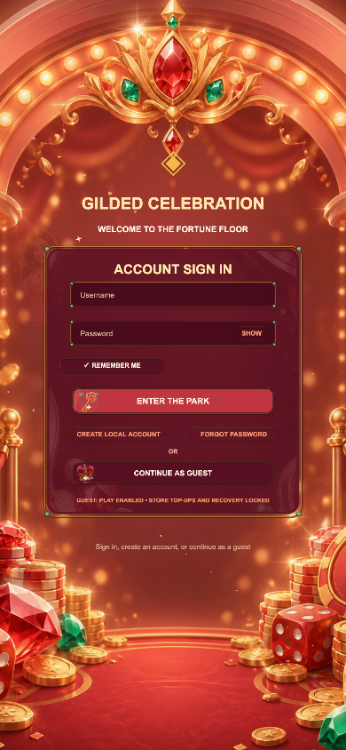
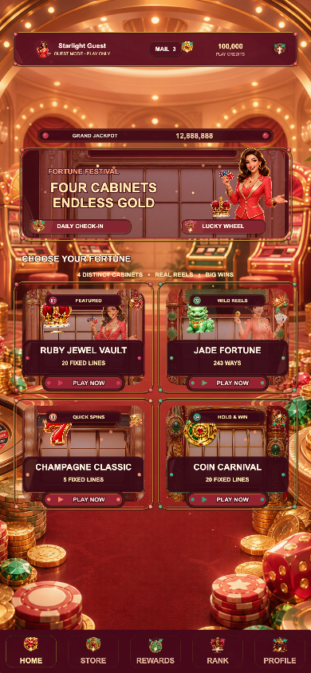
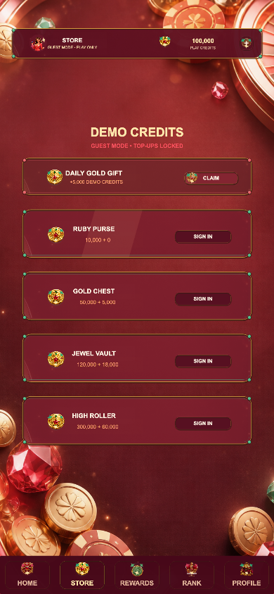
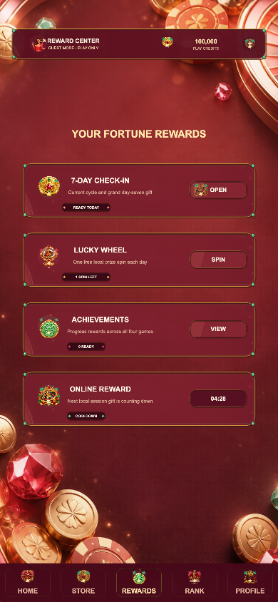
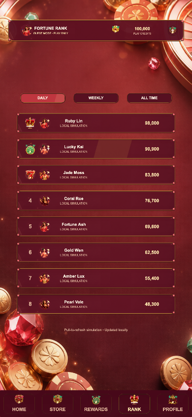
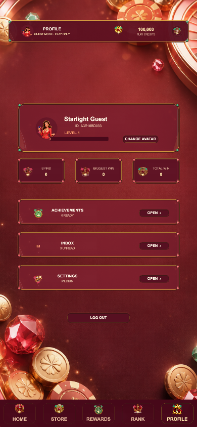
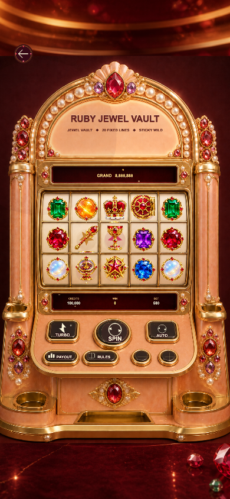
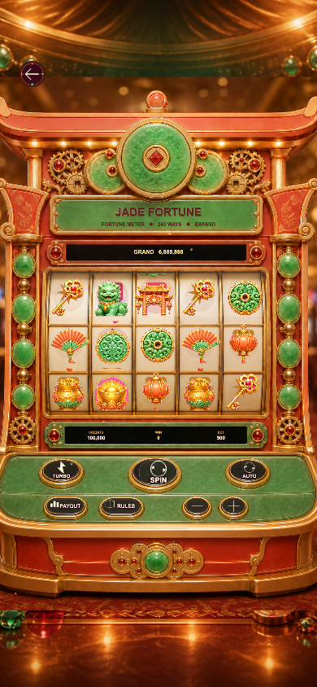
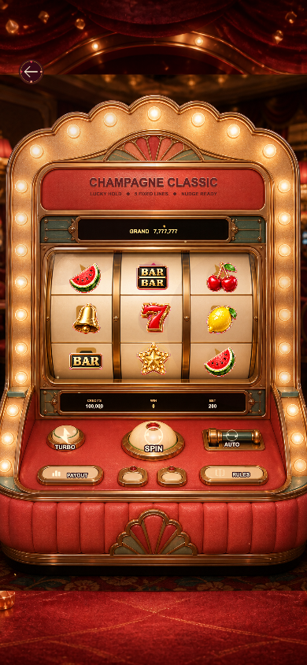
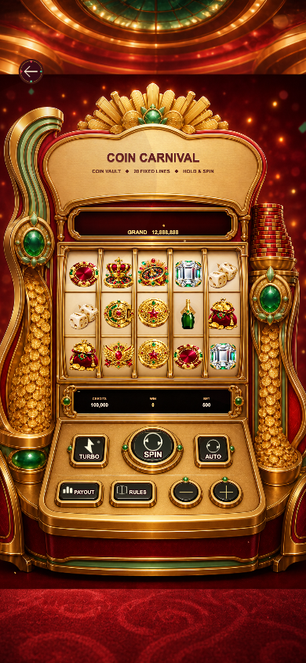

# GILDED CELEBRATION v1.0.0

## 运行截图

| 登录 | 大厅 |
| --- | --- |
|  |  |
| 商店 | 奖励 |
|  |  |
| 排行 | 账户 |
|  |  |
| Astral Vault | Golden Dynasty |
|  |  |
| Neon Classic | Cosmic Coins |
|  |  |

原创 Cocos Creator 3.8.8 竖屏 Slots 合集，以柔和土豪金、金红珠宝、金币筹码和喜庆博彩氛围为统一风格。包含四款独立玩法、四台不同结构的真实柜机、大厅、账号/游客入口、试玩金币、奖励中心、设置、移动端安全区、动效和 VFX。

## 项目内容

- `assets/`：Cocos 场景、TypeScript、原创图片和材质。
- `build-templates/web-mobile/`：移动 Web 加载页与限制为同源资源的 CSP 模板；Cocos 3.8.8 运行时需要受限的 `unsafe-eval` 兼容项。
- `server/`：服务器权威账号、HttpOnly 会话、CSRF、Spin 与幂等结算参考实现。
- `tools/`：数学、账号隔离、异常恢复和 RTP 自动测试。
- `ART_BIBLE.md`、`ASSET_GENERATION_MANIFEST.md`、`MATH_REPORT.md`、`SECURITY.md`：美术、生成链、数学和上线安全基线。

## 开发与验证

```bash
npm ci
npm run typecheck
npm run typecheck:server
npm test
npm run test:rtp
```

用 Cocos Creator 3.8.8 打开项目，构建目标选择 `Web Mobile`。本地权威接口演示：

```bash
cp .env.example .env
npm run server:dev
```

## 运行模式

- 本地预览是明确标识的虚拟金币 Demo；游客可玩，不能增加商店金币。
- 正式上线必须让客户端通过 `ProductionApiClient` 连接服务器，由服务器生成 RNG 结果、验证下注并原子结算。
- `force=win/free/hold/mega/epic` 仅在 localhost 且 `debug=1` 时生效，公网环境关闭。
- Store 的线上票据验证接口默认 fail closed；未接入 Apple/Google/渠道服务前不会增加金币。

这是一套可继续商业化的工程基线，不代表第三方 RNG/数学实验室认证、地区牌照、年龄分级、隐私合规或真实支付审核已经完成。上线前按 `DEPLOYMENT_CHECKLIST.md` 完成外部依赖。
