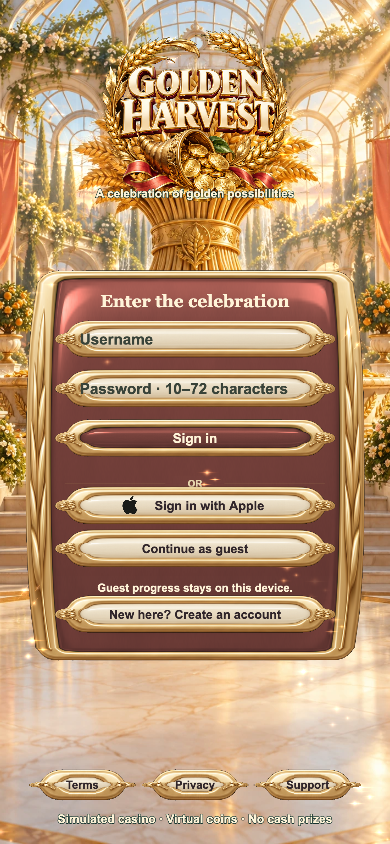
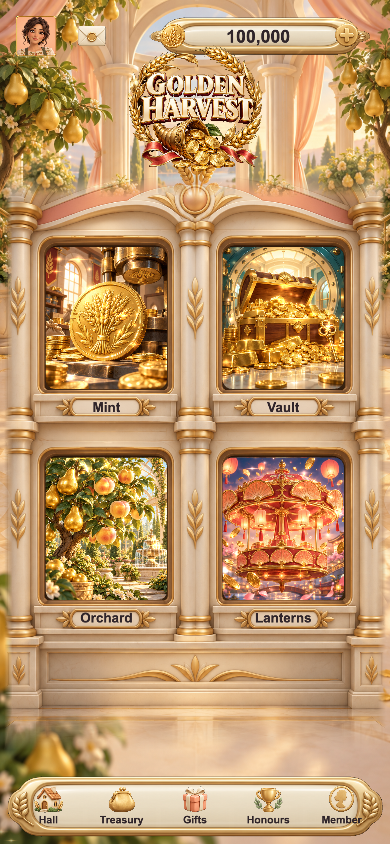
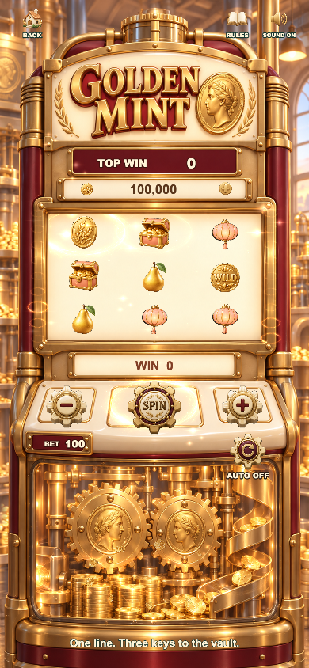
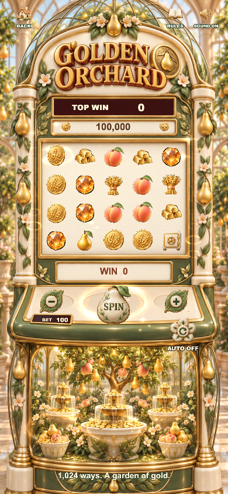
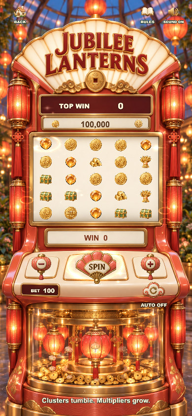
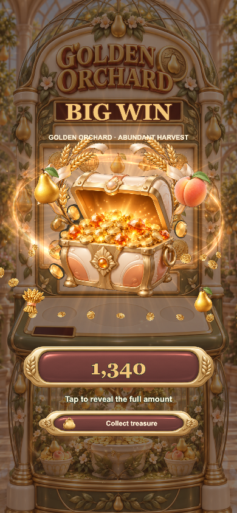
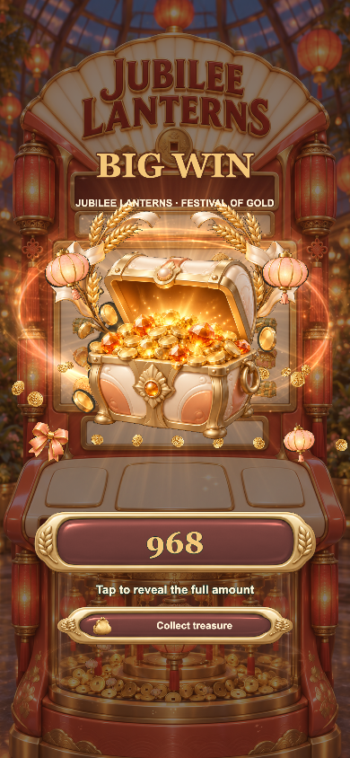

# F13 · Golden Harvest

Cocos Creator 3.8.8 手机游戏工程，以 F8 的玩法与服务架构为基础，接入 F13 独立丰收展馆美术。F8 原工程未修改。

- 四款主题：Golden Mint、Harvest Vault、Golden Orchard、Jubilee Lanterns。
- 独立主题插画入口、柔和卡通头像、登录与注册、宝物商店、奖励、荣誉榜、账户。
- 柜机与转轴共用坐标变换；立体按钮下沉回弹、柜机待机灯光、转轴浮动与粒子、大厅金属边缘扫光。
- 主界面固定屏幕，支持减少动态效果。金币、奖励、排行使用同一服务与钱包状态。

## 运行与验证

预览：`python3 tools/preview_server.py --port 4313`

Cocos 构建配置：`tools/web-mobile-release-build.json`。

检查：`npm test`、`npm run typecheck`。本轮实际渲染截图见 `docs/screenshots`。

## 发行配置

当前是可运行的游戏工程。正式 Apple 登录、StoreKit 商品、服务端与签名仍需发行方配置；本地预览的购买按钮如实显示不可购买，不模拟真实支付成功。参见 `release/`。

F13 旧网页原型已移出工程备份，其服务端账户没有迁移到当前独立的 Cocos 存档。未进行 App Store 提审或真机发行认证。

## 实际运行截图

以下为 Cocos Web Mobile 构建的实际渲染截图。大奖截图使用本地调试奖项触发，以检查演出；不代表正常中奖频率。

| 登录 | 大厅 |
| --- | --- |
|  |  |

| Golden Mint 柜机 | Harvest Vault 柜机 |
| --- | --- |
|  |  |

| Golden Orchard 柜机 | Jubilee Lanterns 柜机 |
| --- | --- |
|  |  |

| 铸币大奖 | 金库大奖 |
| --- | --- |
|  |  |

| 果园大奖 | 灯笼大奖 |
| --- | --- |
|  |  |

更多页面与手机尺寸验证见 [截图目录](docs/screenshots)。
