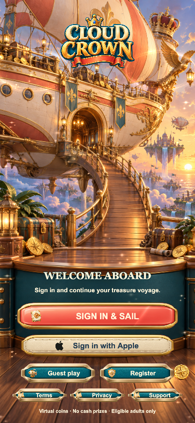
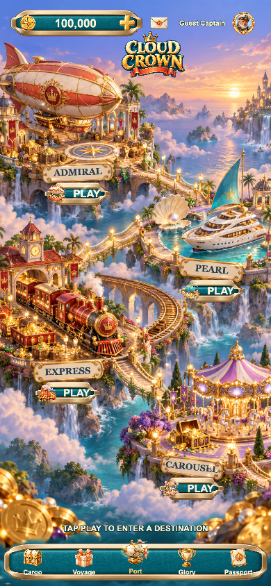
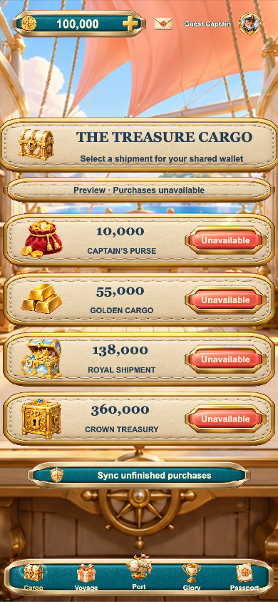
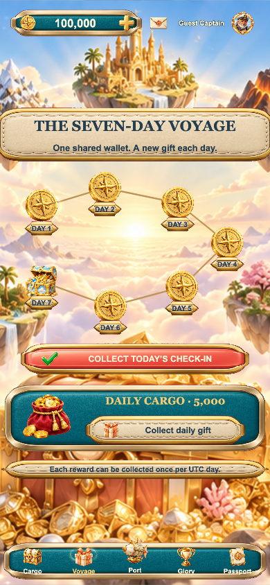
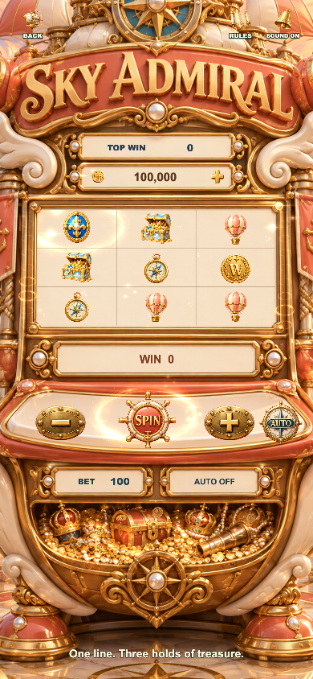
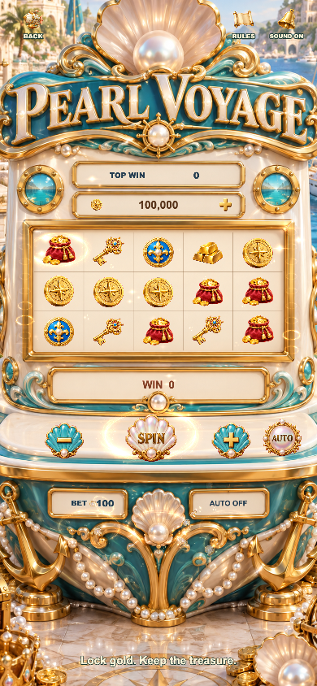
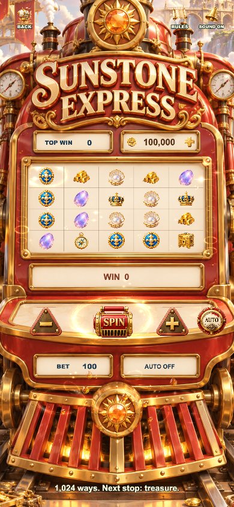
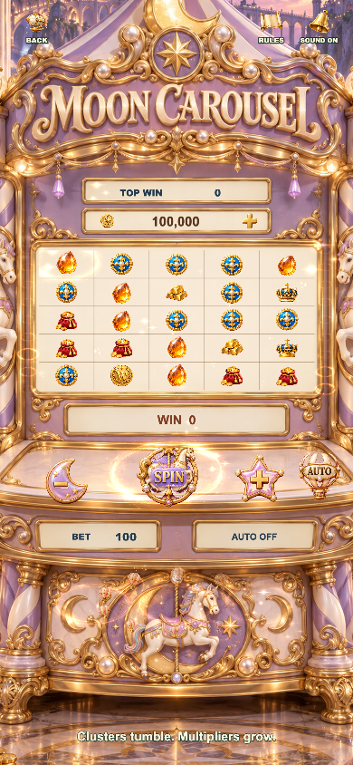
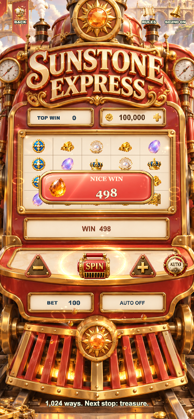
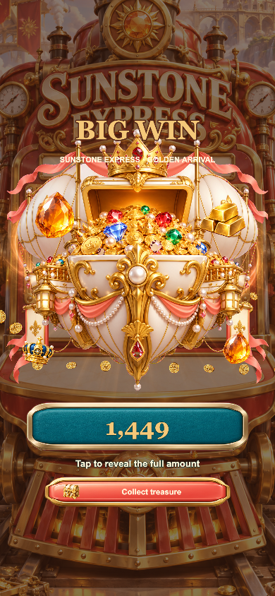

# F14 · Cloud Crown

Cocos Creator 3.8.8 mobile game template: a soft cartoon treasure regatta with four original cabinets, connected treasure-world lobby, cinematic boarding login with an expandable account form, cargo shop, seven-port rewards, honours and captain passport.

## Run

Install dependencies with `npm ci`, open in Cocos Creator 3.8.8 and build using `tools/web-mobile-release-build.json`. Then run `python3 tools/preview_server.py --port 4414`.

Checks: `npm test`, `npm run typecheck`, `npm run typecheck:server`.

Independent save namespace: `cloud-crown-f14.cocos.save.v1`. Rewards, game settlements, purchases and ranking share wallet services. Real Apple sign-in, StoreKit products, server deployment and signing require publisher configuration. Preview purchases report unavailable truthfully. This template has not been submitted to App Store or certified on native iOS devices. See `release/`.

## Runtime screenshots

| Login | Route lobby |
| --- | --- |
|  |  |

| Cargo | Voyage rewards |
| --- | --- |
|  |  |

| Sky Admiral | Pearl Voyage |
| --- | --- |
|  |  |

| Sunstone Express | Moon Carousel |
| --- | --- |
|  |  |

Additional pages and viewport reviews are in `docs/screenshots`. Original artwork prompts and attribution are in `docs/ART_PROVENANCE.md`.

## Win presentations

Ordinary wins (at least the stake) show a short animated award banner. BIG begins at 10×, MEGA at 50× and EPIC at 100×. Presentation never changes the result or credits the wallet again. Below-stake returns are labeled RETURN without a win celebration.

| Ordinary win — presentation preview | Big win — debug round |
| --- | --- |
|  |  |
