# F15 · Honey Parade

A complete Cocos Creator 3.8.8 mobile game template with an original soft-cartoon honey festival art set. The lobby is a single featured theatre with four selectable shows, rather than a world map. The sign-in form sits below the scene; service pages use a two-column boutique, an ordered seven-day reward trail, an honours podium and a portrait-led account page.

## Run

```sh
npm ci
# Open the project in Cocos Creator 3.8.8 and build Web Mobile,
# using tools/web-mobile-release-build.json.
python3 tools/preview_server.py --port 4515
```

Open `http://127.0.0.1:4515/`. Local debug review supports `?debug=1&screen=home` and `?debug=1&screen=game&game=golden-hour`.

## Four shows

| Show | Gameplay |
| --- | --- |
| Bee Treasury | 3×3, one centre payline, treasure pick |
| Peach Jubilee | 5×3, twenty lines, coin lock respins |
| Koi Fortune | 5×4, 1,024 ways, expanding wild bonus |
| Fox Fiesta | 5×5 connected clusters and rising cascades |

Reels, controls, title effects and the integrated cabinet environment share one transform. Each stopped column has a short independent spring; idle symbols, frame reflections and theme-specific title glints remain bounded. Reduced-motion preferences disable decorative movement. Ordinary awards at least equal to the stake receive a short presentation; BIG starts at 10×, MEGA at 50× and EPIC at 100×. Below-stake returns are labeled RETURN. Presentation does not change payouts or credit the wallet again.

The independent save namespace is `honey-parade-f15.cocos.save.v1`. Settled spins, daily gifts, check-in, account statistics and ranking use shared wallet services. Store preview correctly reports unavailable purchases. Native Apple sign-in, StoreKit, server deployment, signing and legal publisher configuration require the publisher's real credentials and device validation; this project does not claim App Store approval.

## Latest interaction updates

The theatre curtains sway gently and close/open during in-place show changes. Each game has a themed loading screen with a progress bar that reaches 100% before entry. Check-in tiles display the day, coin amount and claim state; today's claimed day remains highlighted through the UTC day, including the seventh-day wrap.

## Screenshots

These screenshots were captured from the current Web Mobile build at 390×844 and 320×568.

| Today’s check-in | Claimed day on a small phone | Game loading |
| --- | --- | --- |
| 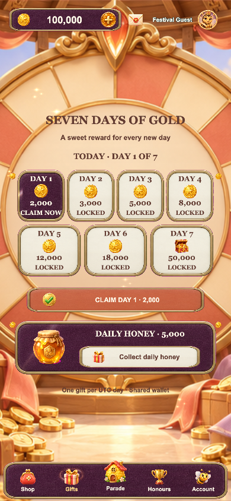 | 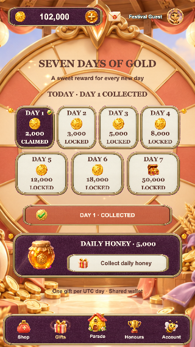 | 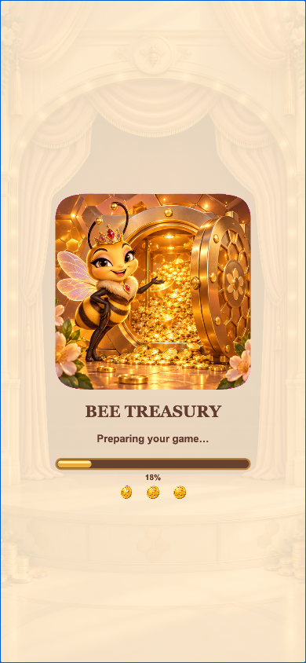 |


| Login | Theatre lobby |
| --- | --- |
| 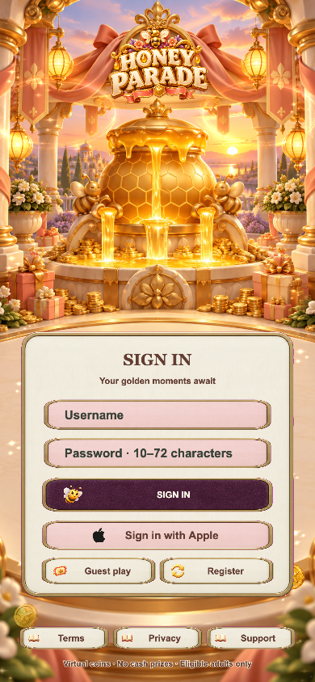 | 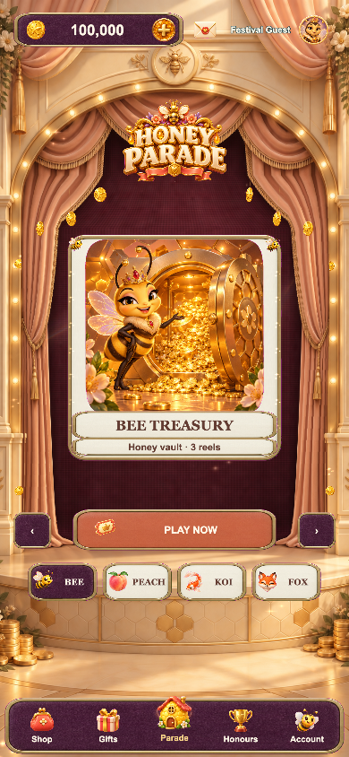 |

| Boutique | Gifts |
| --- | --- |
| 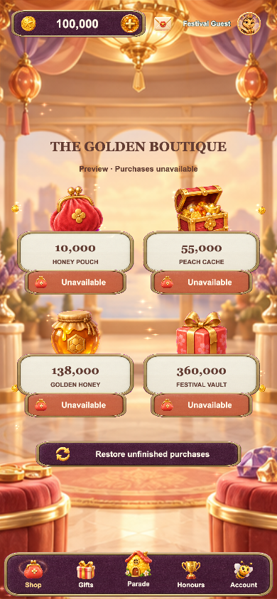 | 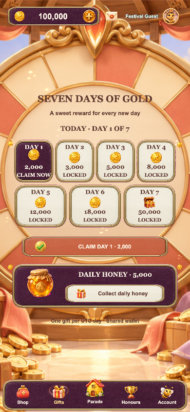 |

| Honours | Account |
| --- | --- |
| 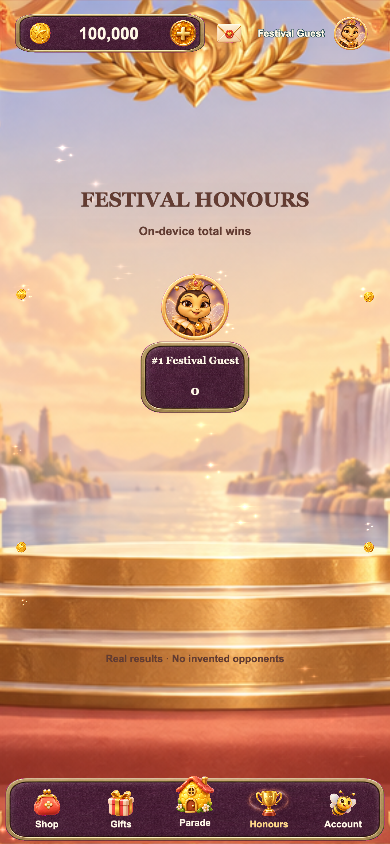 | 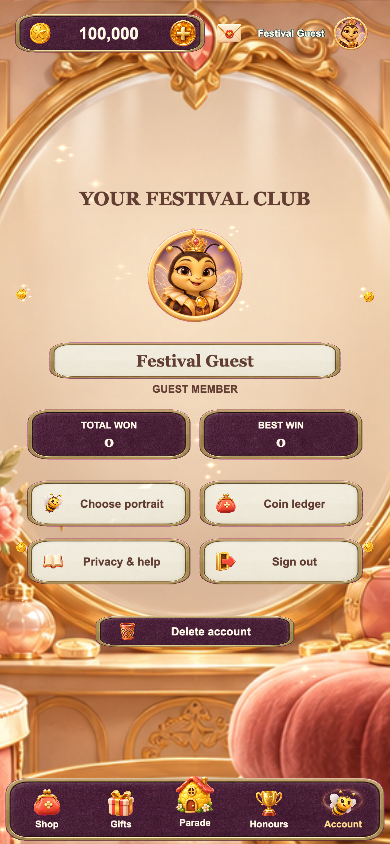 |

| Bee Treasury | Peach Jubilee |
| --- | --- |
| 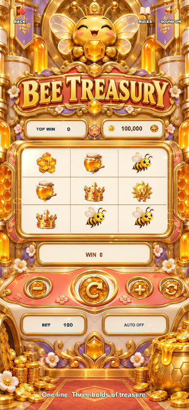 | 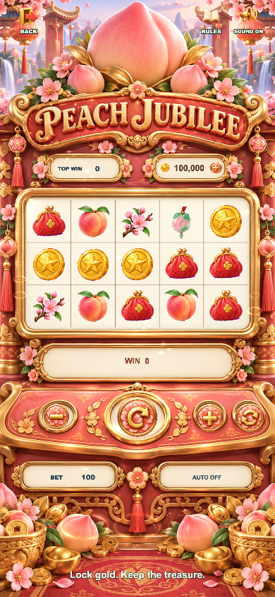 |

| Koi Fortune | Fox Fiesta |
| --- | --- |
| 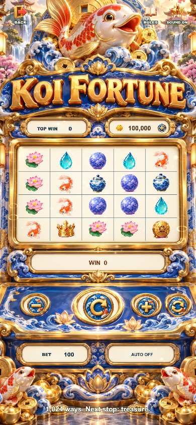 | 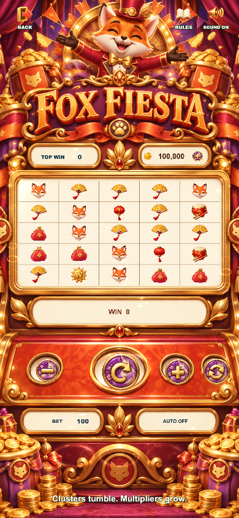 |

| Ordinary win (presentation preview) | Big win (debug round) |
| --- | --- |
| 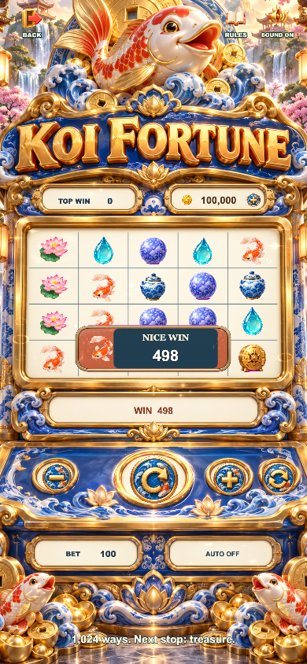 | 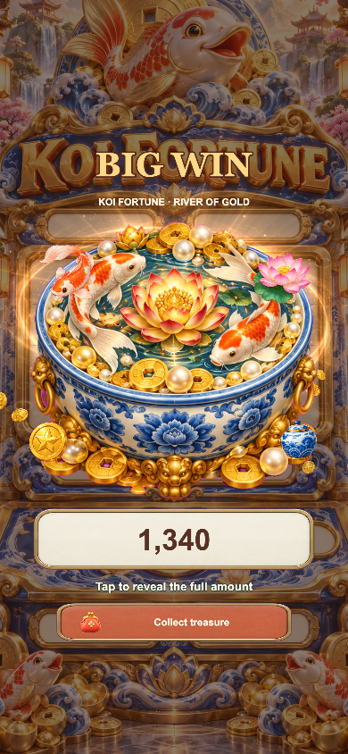 |

Validation details: [QA](docs/QA.md). Art generation and sources: [Art provenance](docs/ART_PROVENANCE.md).
