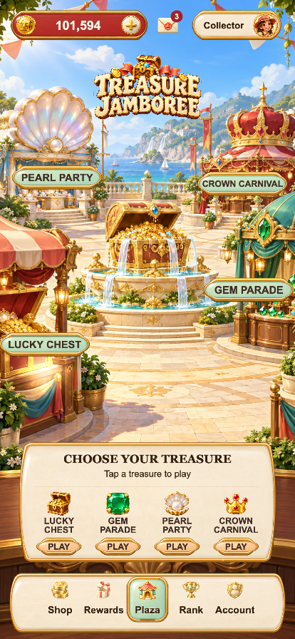
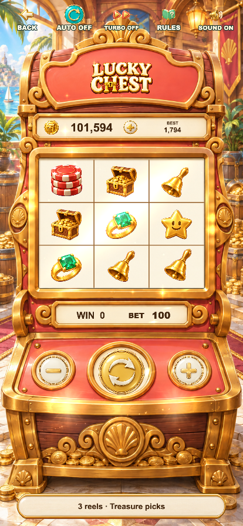
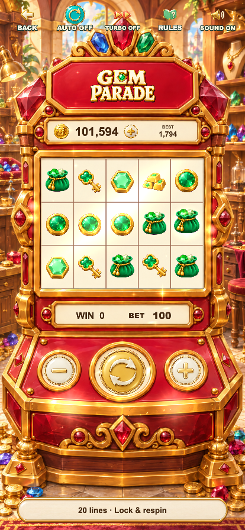
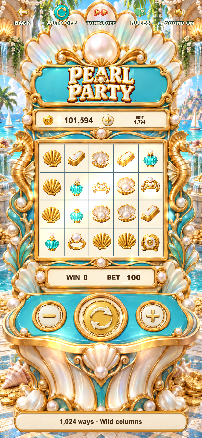
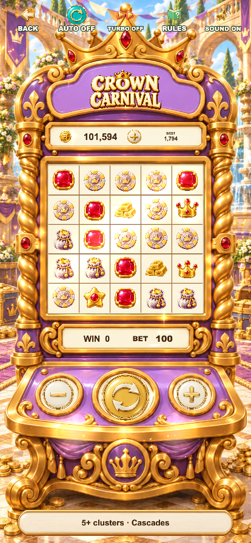

# F16 · Treasure Jamboree — runtime screenshots

Captured on 2026-09-20 from the current Cocos web-mobile build, at a
414 × 896 browser viewport. Each image was captured after the startup loader
disappeared and the page settled. These are browser captures, not iPhone or
App Store approval evidence. They show the current guest account; the store
correctly reports purchases unavailable without native integration.

| Page | Screenshot |
| --- | --- |
| Hall | [Home](F16_Treasure_Jamboree_Home.png) |
| Login | [Login](F16_Treasure_Jamboree_Login.png) |
| Shop | [Shop](F16_Treasure_Jamboree_Shop.png) |
| Rewards | [Rewards](F16_Treasure_Jamboree_Rewards.png) |
| Ranking | [Rank](F16_Treasure_Jamboree_Rank.png) |
| Account | [Account](F16_Treasure_Jamboree_Account.png) |
| Lucky Chest | [Lucky Chest](F16_Treasure_Jamboree_Lucky_Chest.png) |
| Gem Parade | [Gem Parade](F16_Treasure_Jamboree_Gem_Parade.png) |
| Pearl Party | [Pearl Party](F16_Treasure_Jamboree_Pearl_Party.png) |
| Crown Carnival | [Crown Carnival](F16_Treasure_Jamboree_Crown_Carnival.png) |

## Hall

## Four cabinets

