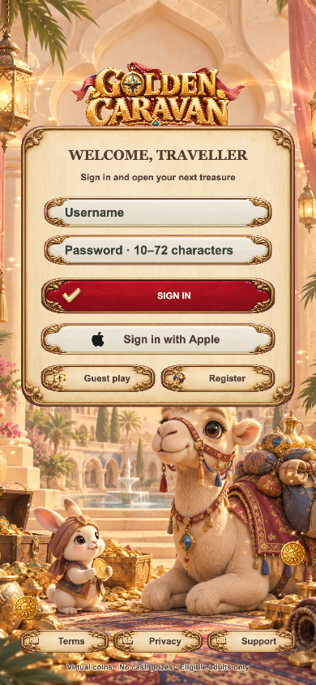
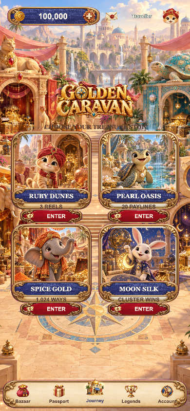
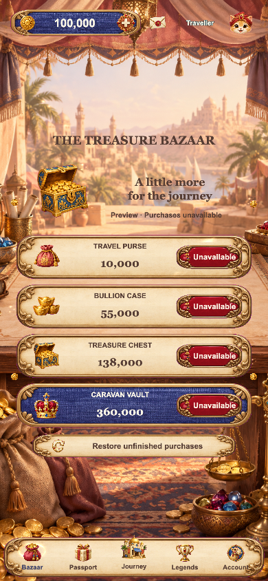
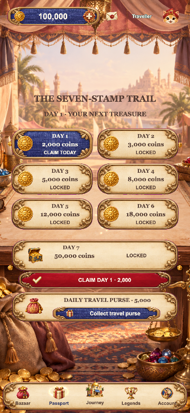
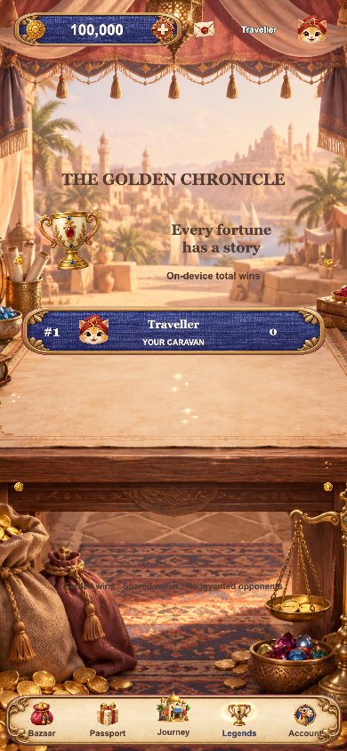
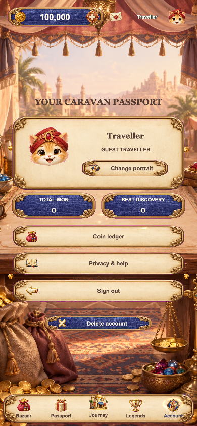
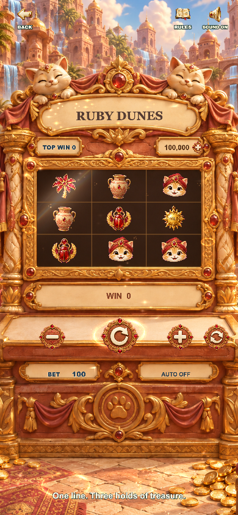
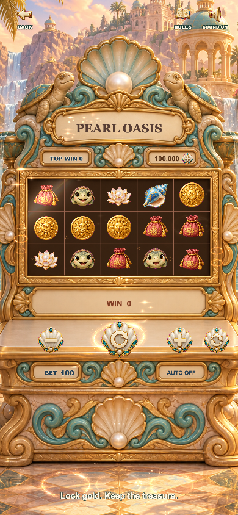
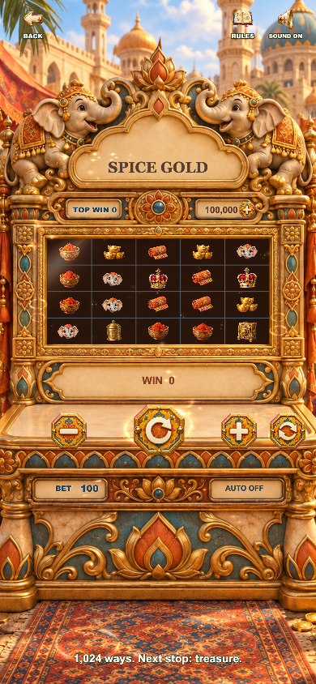
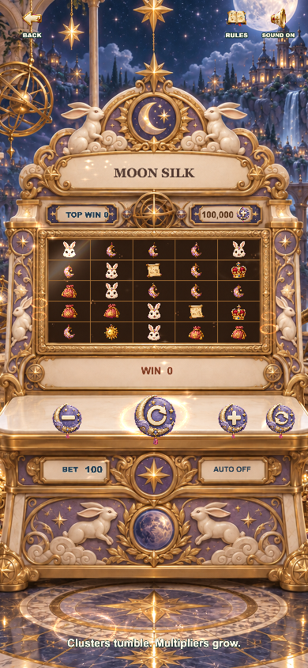

# F17 · Golden Caravan

A complete Cocos Creator 3.8.8 mobile treasure-game template. Warm sandstone, woven silk, brushed gold and friendly storybook characters form a new caravan world, with original illustrations and four independent cabinets.

## Run

```sh
npm ci
# Open in Cocos Creator 3.8.8; build Web Mobile with tools/web-mobile-release-build.json.
python3 tools/preview_server.py --port 4717
```

Preview: `http://127.0.0.1:4717/`. Local review routes support `?debug=1&screen=home`, `screen=rewards`, and `screen=game&game=golden-hour`. Debug fixtures are restricted to localhost. The original F15 project remains separate.

## The four stops

| Destination | Gameplay | Art and materials |
| --- | --- | --- |
| Ruby Dunes | 3×3 centre payline, vault pick | Ruby kitten, scarab, carved sandstone, rose silk |
| Pearl Oasis | 5×3, 20 paylines, coin lock | Turtle, pearl lotus, enamel conch, shell and turquoise |
| Spice Gold | 5×4, 1,024 ways, expanding wilds | Elephant, saffron, woven silk, copper and gold |
| Moon Silk | 5×5 clusters, rising cascades | Rabbit, crescent lantern, star map, lavender and brass |

Internal math IDs stay stable (`golden-hour`, `jade-treasury`, `pearl-palace`, `ruby-revel`). Presentation names and thematic symbol atlases are independent. Shared gold and generic treasure are intentional; character and regional loot never cross into another theme.

## Complete flow

- Illustrated arrival with primary sign-in form, registration, guest consent and correctly proportioned Apple mark.
- Four directly selectable treasure stops; no page scrolling required on phone layouts.
- Entry loading bars follow asset/scene milestones and reach 100% before smooth dismissal.
- Theme-specific physical buttons, masked reels, elastic stops, touch sparks, idle symbols, metal reflections and animated cabinet lettering.
- Ordinary awards, BIG / MEGA / EPIC presentations, themed prize art and skippable count-up. Presentations never credit the wallet a second time.
- Bazaar bundle list, seven-stamp check-in passport, separate daily purse, real saved leaderboard, traveller passport, portraits, ledger, privacy, logout and deletion.
- Shared wallet and exact-once settlement; reduced-motion support, safe areas, keyboard-safe login fields and retained outgoing scene during page transitions.

Independent storage: `golden-caravan-f17.cocos.save.v1`.

## Runtime screenshots

Captured from the current Web Mobile build; they are not design mockups.

| Arrival / sign-in | Caravan courtyard |
| --- | --- |
|  |  |

| Bazaar | Seven-stamp passport |
| --- | --- |
|  |  |

| Golden chronicle | Traveller account |
| --- | --- |
|  |  |

| Ruby Dunes | Pearl Oasis |
| --- | --- |
|  |  |

| Spice Gold | Moon Silk |
| --- | --- |
|  |  |

## Validation and publishing

`npm test`, `npm run typecheck`, `npm run typecheck:server`. See [QA](docs/QA.md) and [art provenance](docs/ART_PROVENANCE.md).

This is a virtual-coin game template, with no cash-out. Native Apple sign-in, StoreKit product IDs, the production backend, publisher legal information, signing and real-device review require publisher configuration. Preview purchases accurately report unavailable; there is no simulated purchase success. This template has not been submitted to or approved by the App Store. See `release/` for integration requirements.
