# F18 · Gilded Express · 鎏金特快

Cocos Creator 3.8.8 完整移动端虚拟金币游戏模版。故事书风格的财富列车，以胡桃木、铜金、象牙白、酒红和海军蓝建立统一美术。独立原画、页面构图、四种柜机布局与火车登车加载，不沿用前作大厅卡片或柜机控制台排列。按钮和读数文字按铭牌内侧留白适配，AUTO 状态不随按钮放大。

## 运行

```sh
npm ci
# 用 Cocos Creator 3.8.8 打开，按 tools/web-mobile-release-build.json 构建 Web Mobile。
python3 tools/preview_server.py --port 4818
```

本地预览：http://127.0.0.1:4818/ 。本地审查可用 `?debug=1&screen=home`、`screen=rewards`、`screen=game&game=golden-hour`。调试奖励仅用于本机审查，不代表自然中奖概率。独立存档：`gilded-express-f18.cocos.save.v1`。

## 四条财富线路

| 线路 | 玩法 | 独立柜机设计 |
| --- | --- | --- |
| COCOA COMET | 3×3 中线、宝库选择 | 可可熊铜制机车，左侧方形转轴、右侧纵向按钮 |
| CHERRY LANTERN | 5×3、20 线、金币锁定 | 樱花小熊猫灯笼机车，宽转轴、侧向拉杆与控制钮 |
| CORAL CARGO | 5×4、1,024 ways、扩展百搭 | 海豹珍珠机车，高转轴、下置标题、贝壳控制台 |
| STARLIGHT MINT | 5×5 集群、连消 | 刺猬铸金币机车，左侧大启动钮、右侧调注钮 |

底层稳定 ID 为 `golden-hour`、`jade-treasury`、`pearl-palace`、`ruby-revel`。共享金币与通用财宝；主题角色及特色物件按独立图集配置。

## 页面与交互

- 登录：列车抵站欢迎画面，SIGN IN & BOARD 为主入口；点击后展开登车凭证。支持注册、游客、Apple 登录、清晰输入与退出后重新登录。
- 大厅：一幅完整的玻璃穹顶铁路世界，轨道串联可可工坊、樱花车站、珊瑚港与星光铸币坊；场景铭牌和建筑可直接进入游戏，实体机车缓慢吐蒸汽，车灯轻柔呼吸，入口金属扫光与站台灯饰错峰闪烁。每块铭牌下有明确的 PLAY 按钮，建筑、铭牌与按钮固定在站台上，以局部扫光、灯光呼吸和蒸汽营造动态。
- 加载：原创蒸汽列车沿轨道前行，进度跟随资源/场景阶段，达到 100% 后平滑退场。
- 柜机：背景与机身为同一张完整画面，同一变换绑定转轴、标题、按钮；四张独立材质标题图片带缓慢浮动和扫光。
- 动效：主题金属边缘流动灯、停轴亮度反馈、釉面按钮扫光/高光/呼吸/按压回弹、转轴分隔线、符号待机与落停弹性。减少动态效果设置可关闭装饰动画。
- 普通获奖与 BIG / MEGA / EPIC 演出、主题奖品、可跳过数字累加；演出不重复发放金币。
- 商店：选中行李大图、四档礼包选择与恢复购买入口。奖励：七站通票、明确当前日/已领取/锁定标识、独立每日行李奖励。
- 荣誉：真实保存成绩与领先记录；账户：列车俱乐部、头像、账本、隐私、登出及删除账户。
- 钱包、下注、结算、奖励互通，领取防重；页面切换保留画面，手机无整页滚动。

## 实际运行截图

| 登录 | 车站大厅 |
| --- | --- |
| 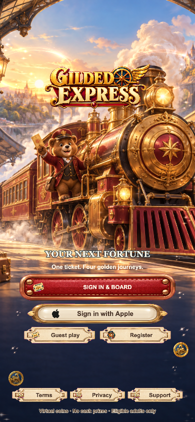 | 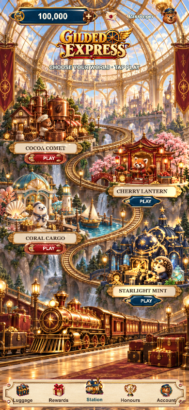 |

| 行李商店 | 七站奖励 |
| --- | --- |
| 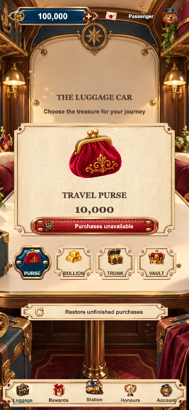 | 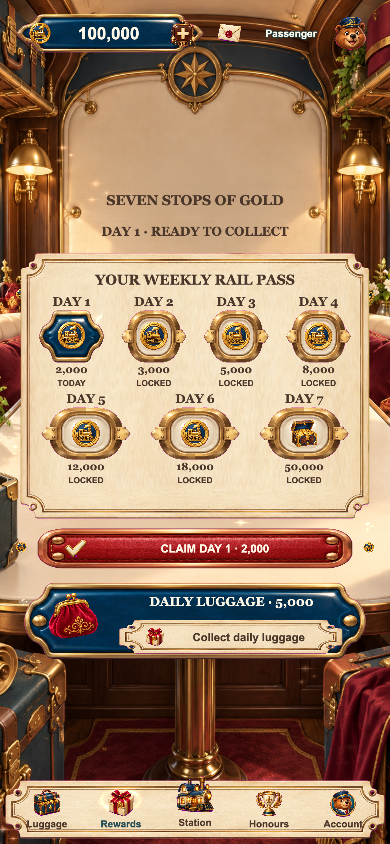 |

| 荣誉 | 账户 |
| --- | --- |
| 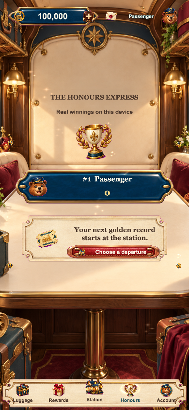 | 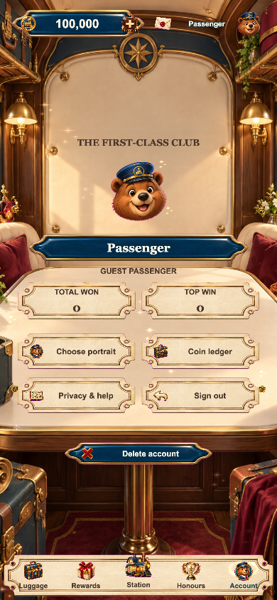 |

| 可可彗星 | 樱花灯笼 |
| --- | --- |
| 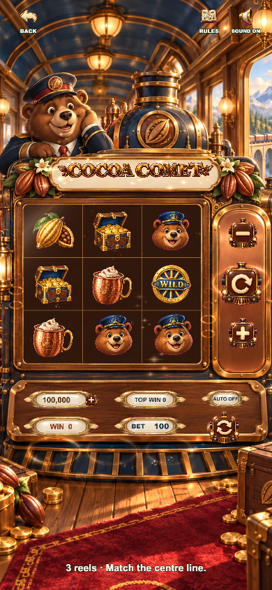 | 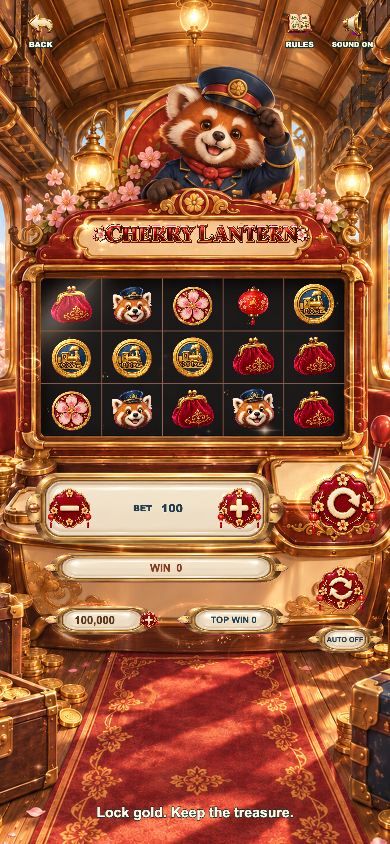 |

| 珊瑚货运 | 星光铸币 |
| --- | --- |
| 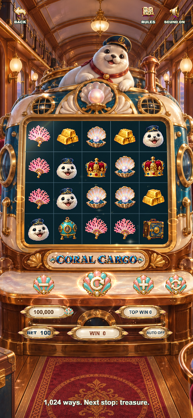 | 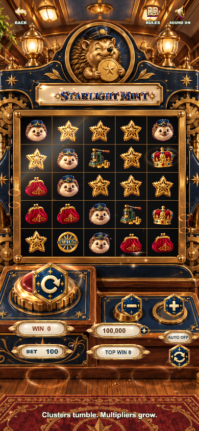 |

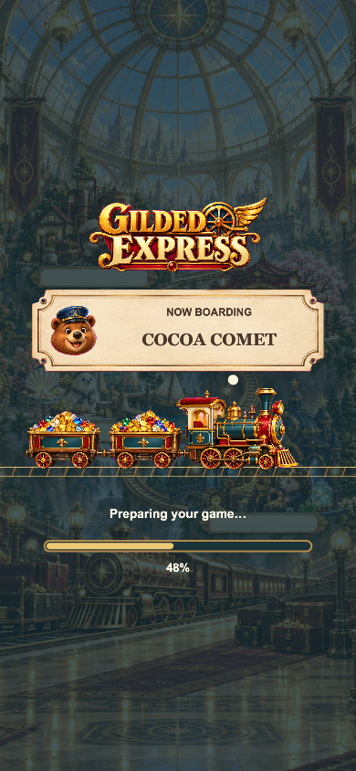

## 验证与接入

`npm test`、`npm run typecheck`、`npm run typecheck:server`。实际浏览器流程、截图和验证记录见 [QA](docs/QA.md)。原创图片与提示词见 [美术来源](docs/ART_PROVENANCE.md)。

本模版使用虚拟金币，不支持提现。原生 Apple 登录、StoreKit 商品、生产服务器、法律信息、签名和真机测试仍需发行方配置。浏览器购买会如实报告不可用，不伪造支付成功。尚未提交或获得 App Store 审核批准；接入要求见 `release/`。
