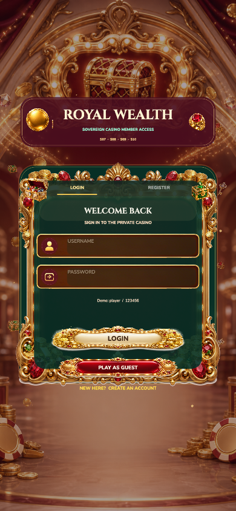
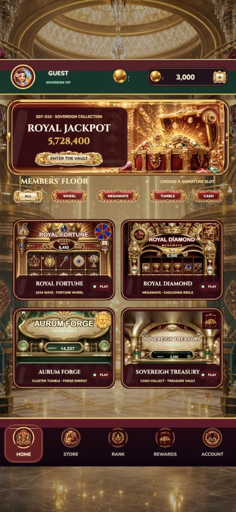
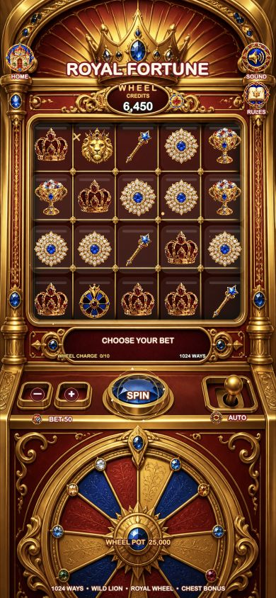
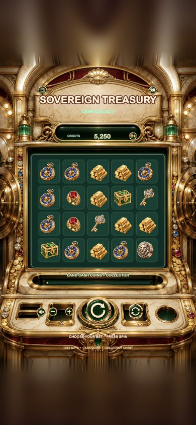

# F1 · Royal Wealth Casino Suite

## 运行截图

| 大厅登录 | 大厅首页 |
| --- | --- |
|  |  |
| S07 Fortune Wheel | S08 Megaways |
|  |  |
| S09 Aurum Forge | S10 Sovereign Treasury |
|  |  |

F1 是一个完整的竖屏赌场游戏模板，由高级财富大厅 L02 和四种不同 Slots 玩法组成：

- S07：5x4 1024 Ways + Fortune Wheel
- S08：6 轴 Megaways + Cascading Reels
- S09：全新 Aurum Forge 6x5 Cluster Tumble + Forge Energy
- S10：5x4 Cash Collect + Treasure Vault

大厅卡片可真实进入对应游戏，四款游戏的 HOME 按钮都会回到大厅。登录、商店、排行、奖励和账户页保持在同一套视觉和交互体系中。

## 快速运行

五个子项目已经有可用的 `build/web-mobile` 时：

```bash
npm start
```

浏览器打开 `http://127.0.0.1:4260/?suite=f1` 。

## 从 Cocos 源码重建

需要 macOS 和 Cocos Creator 3.8.8：

```bash
npm run assemble:build
npm run serve
```

如 Cocos Creator 不在默认位置，可设置 `COCOS_CREATOR_BIN` 为可执行文件路径。

## 目录结构

```text
F1_Royal_Wealth_Casino_Suite_v1.0.0/
├── suite-manifest.json
├── scripts/
│   ├── assemble.mjs
│   ├── serve.mjs
│   └── verify-dist.mjs
└── dist/                 # 本地组装产物，不重复提交生成资源
    ├── index.html            # L02 大厅入口
    └── games/s07…s10/   # 四款真实游戏
```

`dist/` 通过清单从同一 Git 仓库中的模板源码可重现生成，避免在仓库内重复存储数百 MB 的 Web 构建缓存。
