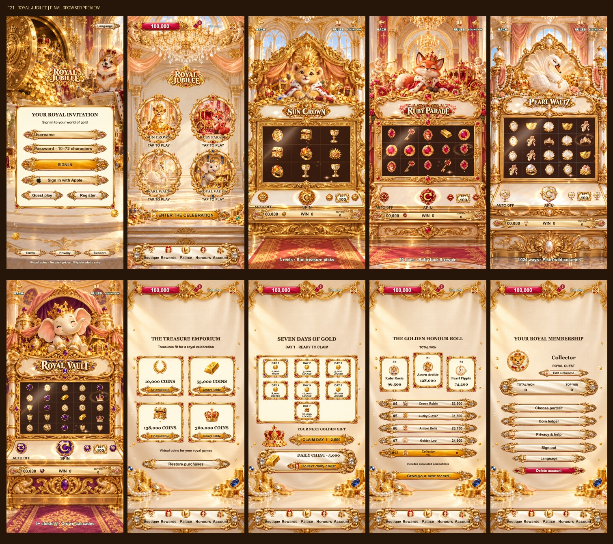

# F21 · Royal Jubilee · 皇家宝藏庆典

Cocos Creator 3.8.8 移动端虚拟金币游戏模版。金雕宫殿、珠宝、柔和卡通动物与四套独立柜机组成皇家庆典。

## 运行

```sh
npm ci
# Cocos Creator 3.8.8 打开本项目，使用 tools/web-mobile-release-build.json 构建。
python3 tools/preview_server.py --port 5121
```

预览：http://127.0.0.1:5121/ 。本地审查可使用 `?debug=1&screen=home`，游戏使用 `screen=game&game=golden-hour`。

## 完整流程

- 独立皇家登录画面、注册、游客入口、Apple 标志和账号表单。
- 四座同时呈现的宫殿入口，直接点击进入；横向手势切换选中主题，独立开始按钮。
- 皇家印章加载动画、进度条和每个模式的进入过渡。
- 四套完整宫殿柜机背景，转轴与控制台共用变换，SPIN 居中；独立标题、按钮、符号、待机光泽。
- 平滑起转减速、落轴回弹、分隔线、主题符号反馈、普通中奖和分级大奖演出。
- 四档商品的双列展示；七日签到三层陈列；荣誉前三名领奖台；账户会员证书与独立操作行。
- 16 个柔和卡通头像；共用钱包、奖励防重、账本、音效设置和减少动态效果设置。
- 默认英语，支持简体中文、繁体中文、日语、韩语，保存用户语言选择。
- 玩家与明确标注的虚拟伙伴共同排序；演出不重复发币。

| 柜机 | 核心玩法 | 主题 |
| --- | --- | --- |
| SUN CROWN | 3×3 中线与金库选择 | 狮子、太阳皇冠、琥珀金 |
| RUBY PARADE | 5×3，20 线与锁币重转 | 狐狸、红宝石、皇家巡游 |
| PEARL WALTZ | 5×4，1,024 ways 与扩展百搭 | 天鹅、珍珠、舞厅 |
| ROYAL VAULT | 5×5 集群连消与递增倍率 | 小象、紫金宝库、财宝 |

稳定技术 ID 依次为 `golden-hour`、`jade-treasury`、`pearl-palace`、`ruby-revel`。F21 使用独立存档与商品命名空间；数学和服务核心沿用已验证实现。

## 截图



截图与验证结果见 `docs/screenshots/`；测试范围见 `docs/QA.md`。

## 验证与发布边界

```sh
npm run typecheck
npm test
npm run typecheck:server
```

这是可运行的完整模版，并非已完成商店发行的产品。真实 Apple 登录、StoreKit 内购、订单验证和生产账户服务需要配置签名、商品、服务端与原生桥接，参见 `release/`。浏览器不会模拟购买成功或凭空发币。调试强制中奖用于演出检查，不代表自然中奖概率。
