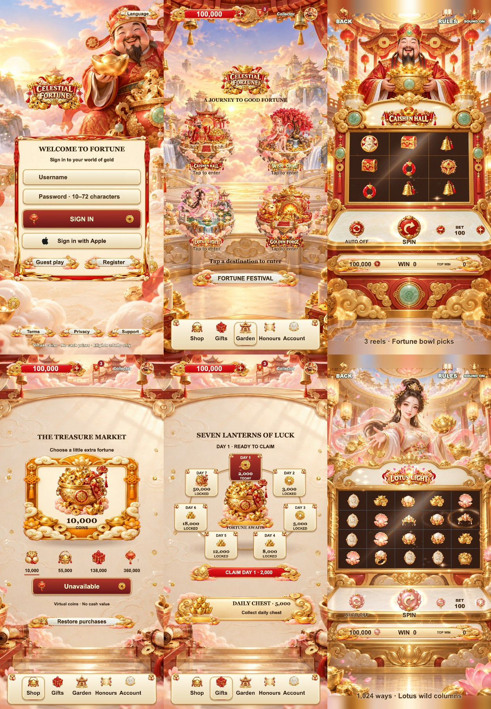

# F22 · Celestial Fortune · 天宫聚宝盛会

独立的 Cocos Creator 3.8.8 完整游戏模板。财神、如意精灵、莲灯仙子、聚宝仙翁四个主题，朱红与香槟金的天宫场景；默认英语，支持简体中文、繁体中文、日语、韩语。

## 运行

```sh
npm ci
npm test
# 使用 Cocos Creator 3.8.8 打开工程并构建 Web Mobile，或：
/Applications/CocosCreator.app/Contents/MacOS/CocosCreator --project "$PWD" --build "configPath=$PWD/tools/web-mobile-release-build.json"
python3 tools/preview_server.py --port 5222
```

本地预览：`http://127.0.0.1:5222/`。首次选择 Guest play 后确认条款，即可体验。开发检查支持 `?debug=1&screen=home`；正式发布前应按 release 文档配置生产模式与后端。

## 本版内容

- 财神迎宾登录、聚宝盆金币加载进度、可反复滑动的天宫场景大厅。
- 四种规则：3×3 中线、5×3 二十线锁定重转、5×4 1024路、5×5 连簇消除。
- 原创四套整景柜机、主题转轴图集、按钮、标题、头像、奖品；标题浮动扫光，转轴减速回弹，普通及大奖演出。
- 签到祈福牌、每日宝箱、独立庆典抽选与局数奖励、账户改名及头像选择。
- 邮箱已读/未读、单封和批量附件领取、保护未领取邮件；玩家与模拟参赛角色一起排序。
- 本地存档隔离、交易记录、五种语言、音效开关、返回前旋转状态保护。
- 内购接口、服务端验单和 Apple 登录接口结构保留；未配置原生桥接时诚实显示不可用，不虚假发币。

## 验收与边界

实际截图见 `docs/screenshots`，检查结果见 `docs/QA.md`。网页版本已运行并通过功能与多尺寸渲染检查。iOS 真机、StoreKit 沙盒、正式服务端、隐私/条款及 App Store 提交仍需要发行方配置和验收；本工程不是已经通过苹果审核的发行包。

## 最新实机尺寸预览

以下为 414×896 浏览器渲染截图，非 iPhone 真机截图。完整截图见 [截图展示页](docs/SCREENSHOTS.md)。


