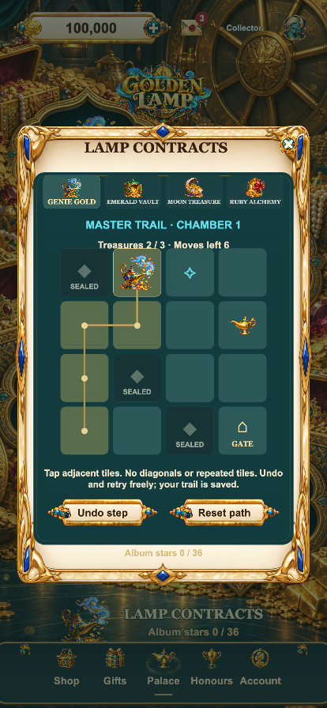
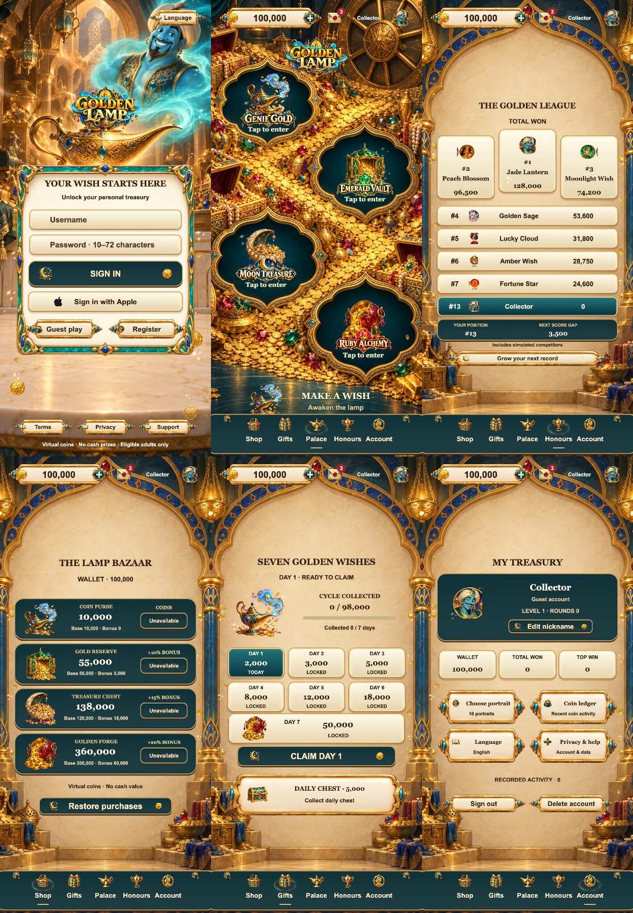

# F23 · Golden Lamp · 金灯秘境

Cocos Creator 3.8.8 游戏模板，以金灯精灵、翡翠宝库、月光秘藏、红宝炼金构成黄金魔法宫殿。默认英语，可切换简体中文、繁体中文、日语、韩语。

## 运行

```sh
npm install
npm test
/Applications/CocosCreator.app/Contents/MacOS/CocosCreator --project "$PWD" --build "configPath=$PWD/tools/web-mobile-release-build.json"
python3 tools/preview_server.py --port 5323
```

本地预览 `http://127.0.0.1:5323/`。Guest play 确认条款后进入；开发调试支持 `?debug=1&screen=home`。

## 内容

- 金灯精灵登录、宝石环绕加载与进度条、开放藏宝洞大厅、四个错落的直达柜机入口。
- 四种游戏规则：3×3 单线、5×3 二十线重转、5×4 1024路、5×5 连簇消除。
- 四套主题图标和按钮；三个原创整景柜机框架，金灯柜机采用翡翠框架与独立魔灯前景组合。转轴、标题、操作台共享坐标变换；背景使用同源顶部/中央/地面连续分区适配，中央柜机不拉伸。
- SPIN 位于中心，左侧调整投注、右侧 AUTO；逐列停靠回弹、金属扫光、主题待机光点及普通/大奖演出。
- 四宝物独立陈列宝市、七日祈愿签到、每日宝箱、独立魔灯祈愿、局数里程碑。
- 昵称修改、16个头像、邮件阅读和附件领取、账本、玩家与模拟角色共同排名。
- 保存隔离、奖励防重复、远程模式接口、五语言和减少动态效果选项。

## F23 独立玩法：金灯寻宝

大厅底部 **LAMP CONTRACTS** 或柜机顶部 **TRAIL** 进入。四个主题各有三间秘室，收集星章最多 36 枚。

- 每个主题赠送 8 点灵光，足够免费体验一次。该柜机每次成功结算的转动增加 1 点；魔灯 / 翡翠钥匙 / 月光珍珠 / 红宝石每个再加 1 点，每局最多额外 2 点。储量上限 24，与投注金额无关。
- 每次开启挑战消耗 8 点。悠游模式要求 12 步内收集 2 件宝物并到出口，记录 1 星；进阶模式要求 10 步内收集 3 件，记录 3 星。
- 玩家实际选择相邻格来规划路线，不能斜走、穿墙或重复经过。可以免费撤回或重置；关闭和刷新后继续原路线，不重复扣能量。
- 每间秘室记录最佳星数，重玩不会重复累加星章。进行中的路线、藏品和能量按账户保存。
- 原每日魔灯祈愿与里程碑入口位于 Gifts 页面左上方 **MAKE A WISH**。

星章是本机收藏内容，无金币奖励、现金价值或兑换用途。基础转轴的概率、赔付和金币余额逻辑保持原值；远程钱包模式也只在有效服务器结果结算时增加本地收藏进度，不由客户端发币。收藏尚未提供跨设备云同步。

验证：`npm run test:contracts`，覆盖所有 24 种主题/秘室/难度组合的可解性、恢复、防重复、账户隔离、结算原子性。详细记录见 `docs/QA.md`。



## 发行边界

这是可运行的模板，不是已通过 App Store 审核的发行包。Apple 登录、真实内购、生产后端、隐私条款均需发行方配置。未连接原生购买桥接时，商品显示 Unavailable，不虚假发币。排名明确标注包含模拟参赛角色。金币无现金价值。

## 截图与检查

截图来自浏览器渲染，不代表 iPhone 真机测试。检查记录见 `docs/QA.md`。


