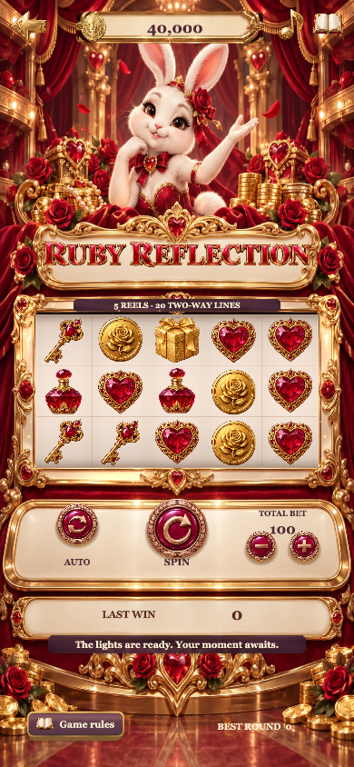

# F25 · Velvet Fortune — Cocos Creator

独立的 Cocos Creator **3.8.8** 工程。场景、转轴、交互、遮罩、动画和弹窗由 Cocos 原生节点渲染，没有 iframe 或旧 H5 页面嵌套。F25 原创图像保持独立，未使用 F20–F23 的美术资源。

## 运行

1. 使用 Cocos Creator 3.8.8 打开本目录。
2. 打开 `assets/scenes/VelvetTheatre.scene`，运行预览。
3. 命令行：`npm install`，然后 `npm run build:web`、`npm start`。
4. 浏览器访问 `http://127.0.0.1:5526/`。

macOS 默认 Creator 路径为 `/Applications/CocosCreator.app/Contents/MacOS/CocosCreator`，可通过 `COCOS_CREATOR` 环境变量覆盖。构建输出位于 `build/web-mobile`，不纳入源码。构建失败会返回非零状态。

## 游戏内容

- 本地账号登录／注册、游客、条款／隐私／帮助、四个主题入口、独立加载进度、商店、七日签到、每日赠礼、混合示例玩家排行榜、账户、16 个头像、邮箱与金币流水。
- 英语默认，支持简体中文、繁体中文、日语、韩语。余额和选择保存于当前设备。
- 四台柜机采用独立主题符号、标题与按钮。中央 SPIN、左侧 AUTO、右侧总投注与加减。
- 原生转轴加速、匀速、逐轴减速、回弹；符号待机、中奖图案独立金色相框、材质扫光、标题浮动、舞台光束、金币汇入与普通／BIG／MEGA／ROYAL OVATION 演出。
- 自动旋转 10／25／50 次，允许中途停止；进入后台停止后续自动轮次。
- 备份／导入适用于 Web 构建。本地存档与原 H5 工程独立。

## 四种规则

| 模式 | 规则 |
| --- | --- |
| Crown Classic | 3×3，5 条固定线，从左至右 |
| Ruby Reflection | 5×3，20 条双向线，每线只取较高方向一次；3／4／5 个不同转轴出现 SCATTER，额外 2／5／20 倍总投注 |
| Pearl Parade | 5×3，243 ways；有 WILD 的中奖路径翻倍一次 |
| Golden Encore | 5×3，10 条固定线；至少 3 个不同转轴出现 SCATTER，触发 8 次免费旋转；每次免费中奖提升下一次倍率，最高 5×，不重复触发 |

总投注档位 50／100／250／500／1000／2500。赔付由实际生成结果计算，先保存待结算轮次，再播放动画。所有免费步骤合计与主轮共用 1000 倍投注上限。刷新恢复待结算轮次，避免重复发奖。赔付表与引擎共享同一公式。

## 验证与资料

- `npm test`：规则、符号、存档与奖励逻辑测试。
- `npm run audit:math`：固定种子、每模式 50,000 轮模拟；结果是样本统计，不是认证或未来回报承诺。
- 已启动预览服务并安装本机 Chrome 后，运行 `npm run qa:interaction`、`npm run qa:layout`、`npm run qa:awards`、`npm run qa:stability`、`npm run qa:soak`、`npm run qa:profile`。测试使用独立访客上下文，不修改日常浏览器存档。
- `docs/QA.md`：验证范围、可复查结果与未验证范围。
- `docs/screenshots/`：Cocos Web 构建实际截图。

调试预览可添加 `?debug=1`，仅该参数开启时暴露 `window.f25Cocos`。普通访问不暴露测试接口。`preview('big'|'mega'|'epic'|'ordinary')` 只预览演出，不发放金币。

## 当前交付边界

这是完整的本地虚拟金币游戏工程。支持本地用户名密码注册／登录与独立游客档案，Apple 入口仅提供未接入提示；商店明确标记免费演示，不包含真实支付、远程账户或现金兑换。本次验证目标为 Cocos Web Mobile；尚未完成 iPhone／Android 实机、Xcode 签名构建及商店上架验收。商业发行须另外完成这些平台验证。

## 当前版本截图

[查看 soft-response-21 全部 14 张运行截图](docs/screenshots/soft-response-21/README.md)（浏览器运行截图）。

