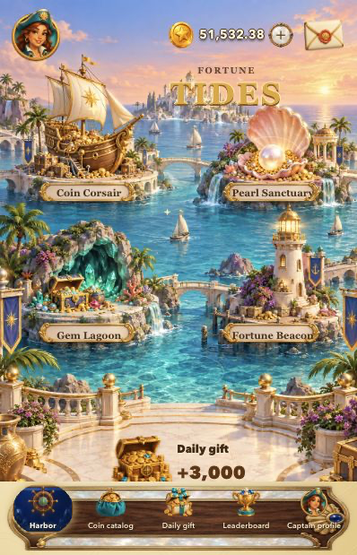
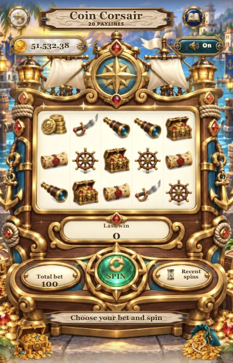
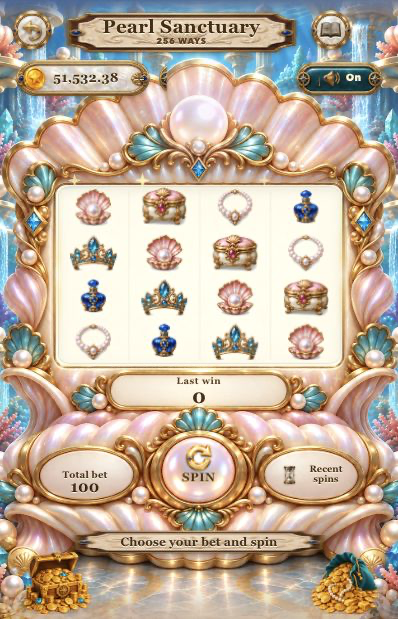
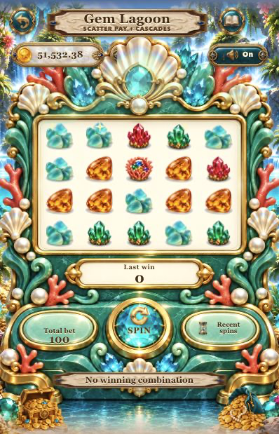
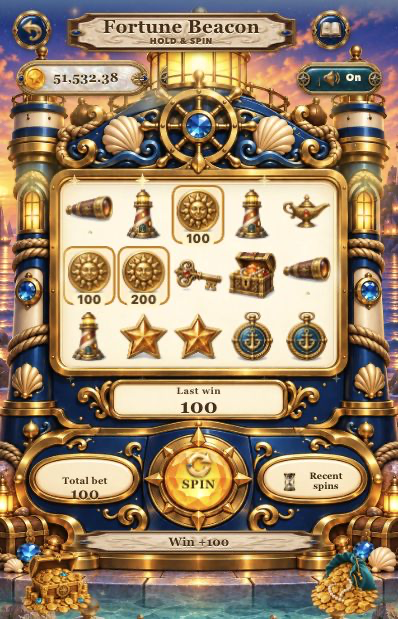

# F26 · Fortune Tides / 潮汐宝港

独立海港寻宝主题的可玩 Web 游戏模板。柔和卡通美术，四座专用柜机，独立数学模块与可取消的 Canvas 动画。

## 运行

需要 Node.js。无第三方运行时依赖。

```sh
npm run dev
npm test
npm run build
```

浏览器打开 `http://127.0.0.1:5626/`。开发调试参数 `?debug=1` 暴露验收接口；生产不带此参数。

## 四种实际玩法

| 柜机 | 核心结算 |
|---|---|
| 金币宝船 | 5×3、20 条固定线、从最左连续至少三个 |
| 珍珠圣殿 | 4×4、256 ways、从最左连续至少三个 |
| 宝石潟湖 | 5×4、八个起散布计数、消除补落、最多八轮 |
| 财富灯塔 | 5×3、金币散布奖、六金币触发锁定重转 |

精确规则及符号赔率见 `docs/MECHANICS.md`；游戏内规则、分模式符号名称与获奖明细支持五种语言。全会话要求与证据见 `docs/SESSION_ACCEPTANCE.md`。

## 已实现

- 四套柜机原画、32个分模式独立透明符号、柜机玻璃内统一裁切。
- 逐列减速、落定回弹、中奖格高亮、粒子消除、按实际空位补落。
- 普通获奖演出；达到本次下注十倍的大奖弹窗和金币演出。
- 个人名称、语言、音效、减少动态设置；本地持久化。
- 真实可领取的本地邮件附件、每日赠礼、防重复领取。
- 24 条明确标注的示例排行及当前玩家记录。
- 商店金币包目录；未接入真实付款时不会扣款或发币。
- 返回/切页销毁动画；开始动画前原子结算一次，中途离开不丢失结果。

## 验证

`npm test`：49 项规则、账本及五语键覆盖测试。浏览器完成四柜机实际转动；五语言 × 两种宽度（320/414）× 七页面的 DOM 横向溢出检查；16 次转动中返回/重进循环，无脚本错误。DOM 检查不能替代原画边框与实际设备视觉验收。

`docs/MATH_SIMULATION.json` 是每模式十万局的确定性模拟结果，仅供开发分析，不代表经过认证的 RTP。

## 当前截图

以下画面对应 `f26-mode-arrivals-41`。四个模式均已加入独立主题加载场景、真实准备进度、防重复进入及柔和入场转场。

### 大厅



### 四台柜机

| Coin Corsair | Pearl Sanctuary |
|---|---|
|  |  |

| Gem Lagoon | Fortune Beacon |
|---|---|
|  |  |

## 发布状态

当前是可试玩与评审的模板，**不是可直接提交 App Store 的签名 iOS 成品**。已有原生容器工程；尚需完整 StoreKit 购买与订单服务、云端数据、防篡改结算、隐私及年龄分级配置、签名与真机测试。详细清单见 `docs/RELEASE_GATES.md`。独立玩法与美术不保证审核通过。

素材使用图像生成工具制作，源提示词归档于开发工作目录；发布前需完成素材权利审核。没有使用参考游戏的原始素材。
