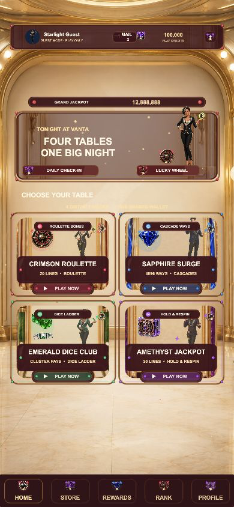

# VANTA NIGHTS CASINO — F2 v1.0.0

## 运行截图



一套原创的 Cocos Creator 3.8.8 竖屏完整 Slots 世界。它不是 F1 的换皮：F2 采用轻奢夜都会赌场世界观，以日蚀钻石徽标、主持人 Ava、黑曜玻璃、银铬金属和明快霓虹作为统一视觉语言，并提供四种真正不同的数学玩法。

## 四个子主题

- `CRIMSON ROULETTE`：5×3、20 条固定线；三枚轮盘 Scatter 触发有输有赢的轮盘 Bonus。
- `SAPPHIRE SURGE`：6×4、4096 Ways；基础赢分后可继续连消，倍率逐级上升。
- `EMERALD DICE CLUB`：6×5 Cluster Pays；相邻符号成簇，骰子触发倍率阶梯。
- `AMETHYST JACKPOT`：5×3、20 条固定线；六枚宝石币触发 Hold & Respin 与四档 Jackpot。

## 商业工程基线

- 纯 TypeScript 数学层与可注入、可复现 RNG。
- 配置化转轴条、赔付表、波动等级、功能触发与最大赢分上限。
- 逻辑结果先生成，表现只消费结果；Turbo / Auto 不改变概率。
- 一份共享试玩钱包，大厅、账号、商店、奖励、规则和设置完整闭环。
- 1080×1920 设计分辨率、安全区适配、对象池、逐轴停靠和分级赢分演出。
- `server/` 提供服务器权威 Spin、幂等结算、会话和 CSRF 参考实现。

## 验证

```bash
npm ci
npm run typecheck
npm run typecheck:server
npm test
npm run test:rtp
```

本地模式明确使用试玩金币。正式真钱或可兑换价值版本必须接入经过认证的服务器 RNG、数学实验室报告、年龄与地区限制、负责任博彩、KYC/AML、支付票据验证和当地牌照；本模板不声称已经取得这些认证。
