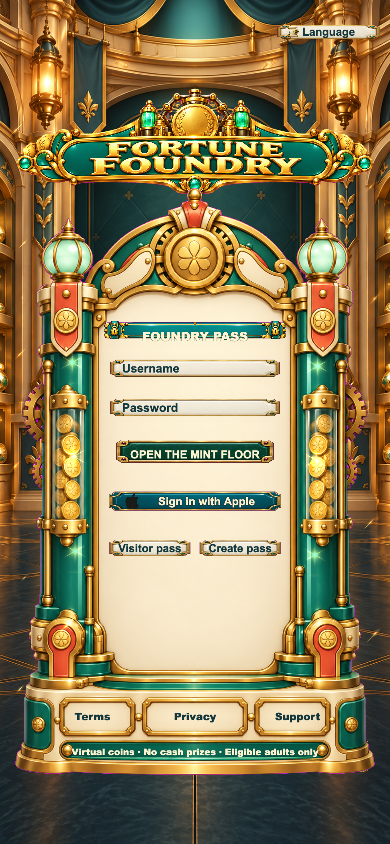
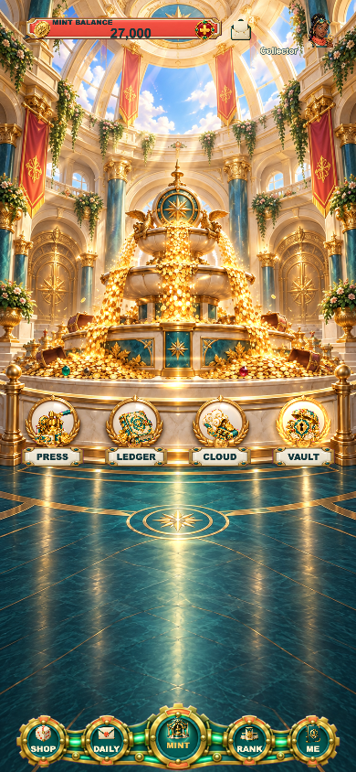
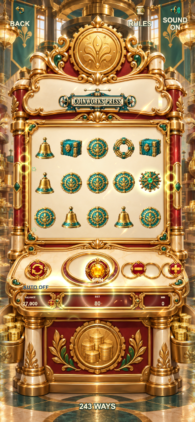
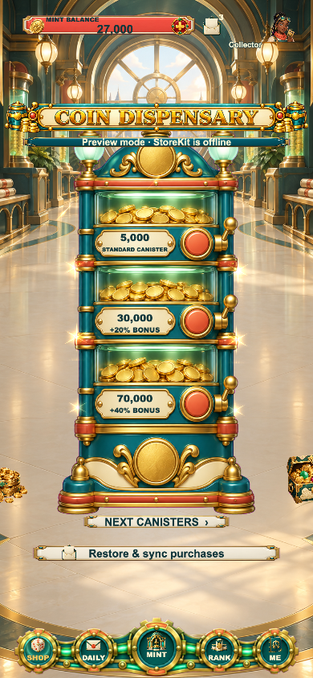

# Fortune Foundry · 财富铸造坊

Cocos Creator 3.8.8 的竖屏虚拟金币游戏模板。统一世界是深青珐琅、暖金机械、玉色玻璃和柔和庆典光影的铸造坊。登录、大厅、商店、奖励、荣誉、账户及四套一体化柜机使用 CC Switch 原创生成图片，而非前作换色；动态文字与数字保持实时排版。

## 运行

```sh
npm ci
npm run typecheck && npm run typecheck:math && npm run typecheck:server && npm test
# 用 Cocos Creator 3.8.8 按 tools/web-mobile-release-build.json 构建 Web Mobile。
python3 tools/preview_server.py --port 5020
```

本地预览 `http://127.0.0.1:5020/`。调试视觉入口：`?debug=1&screen=login`、`screen=home`、`screen=store`、`screen=rewards`、`screen=rank`、`screen=profile`、`screen=game&game=coin-press`。强制中奖仅作演出检查，不代表自然概率。独立存档键：`fortune-foundry-f32.cocos.save.v1`。

## 画面预览（390 × 844）

以下截图来自本地 Web Mobile 运行画面，不是概念图。完整游戏还包含奖励、账户与其余三座柜机。

| 登录 | 铸造坊大厅 |
| --- | --- |
|  |  |

| COINWORKS PRESS | 商店 | 排行 |
| --- | --- | --- |
|  |  |  |

## 四座柜机

| 柜机 | 基础玩法 | 特色 |
| --- | --- | --- |
| COINWORKS PRESS | 5×3，243 Ways，从左至右连续匹配 | WILD 印模沿原轴上升，最多三步 |
| LANTERN LEDGER | 6×5，至少五格正交相连组 | 获奖格复燃为 WILD，增量结算 |
| CLOUD CONVEYOR | 6×5，全盘同种符号至少八枚，不要求相连 | SCATTER 触发五次免费货运和落料 |
| JUBILEE VAULT | 5×3，25 条固定赔付线 | 消除、补充和阶梯倍率连消 |

四种主结算与奖励状态独立；账户、钱包和奖励账本贯通。具体规则见 `docs/GAMEPLAY_V2.md`，美术来源见 `docs/ART_PROVENANCE.md`，测试清单见 `docs/QA.md`。

所有可见背景、装饰、框、按钮、进度轨道/填充、光效、符号和机械演出均是本地 CC Switch 的高质量生成图片。`Sprite.Type.FILLED` 只裁进度图；不可见 `Mask.Type.GRAPHICS_RECT` 只做裁切；可编辑文字由 `Label` 呈现，没有以 Cocos `Graphics` 绘制可见 UI。

仅有不可提现、不可兑换现实价值的虚拟金币。正式发行仍需发行主体、独立 Bundle ID、法律文本、真实 Apple 登录/StoreKit 桥接、商品 ID、生产服务器和 iPhone 真机/沙盒/TestFlight 验收。尚未提交或通过 App Store 审核；参见 `release/README.md`。
