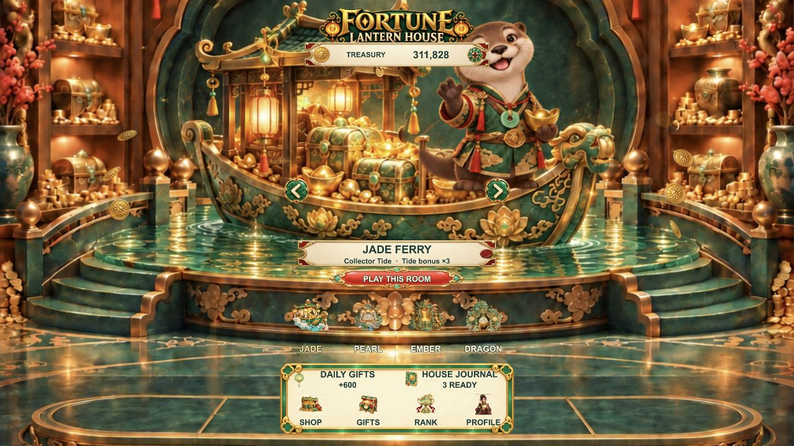
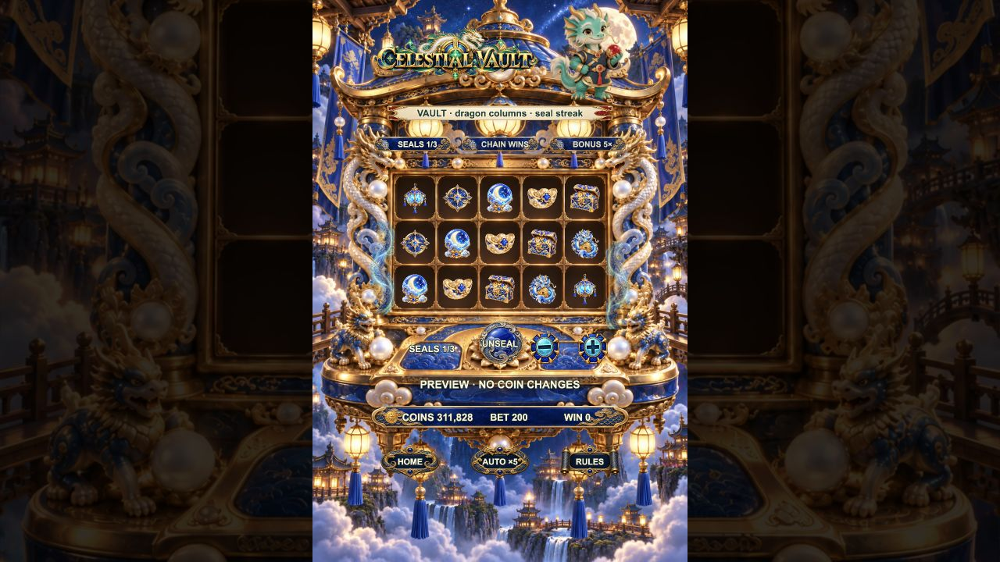
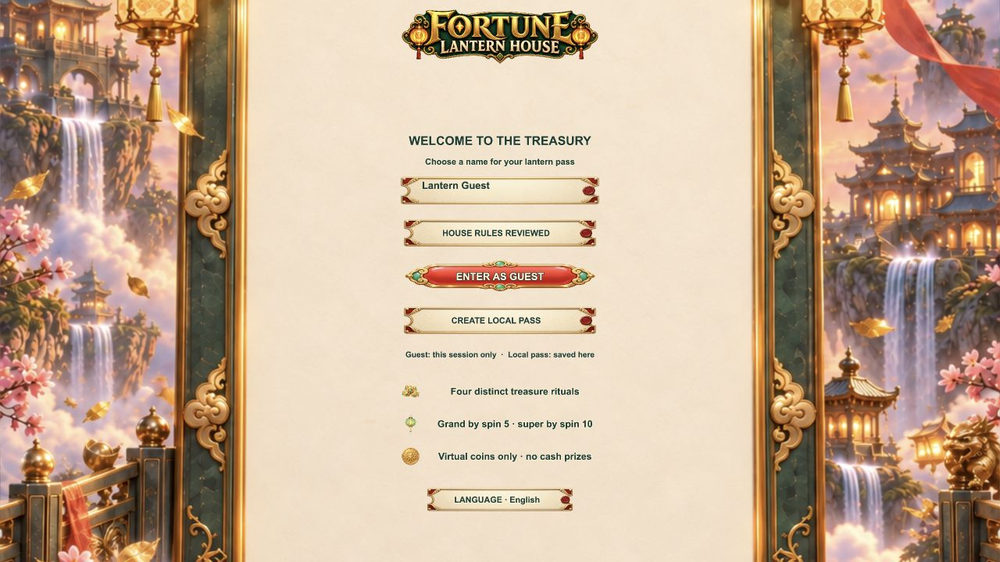
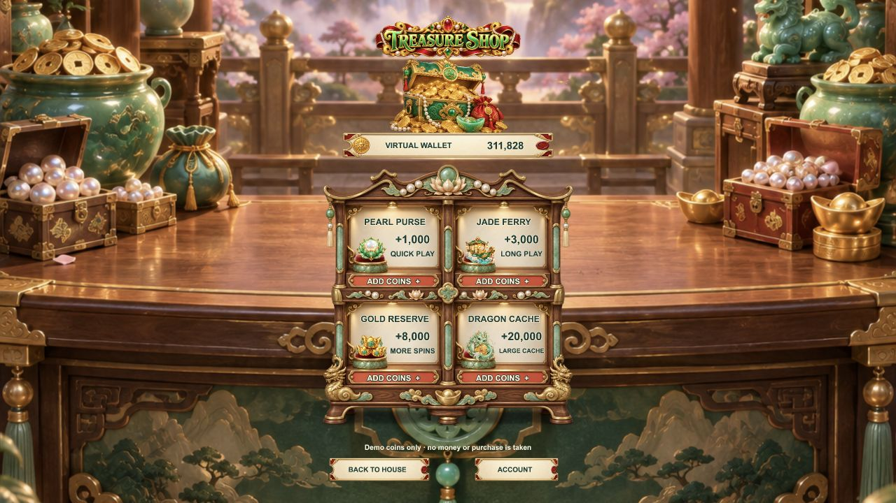
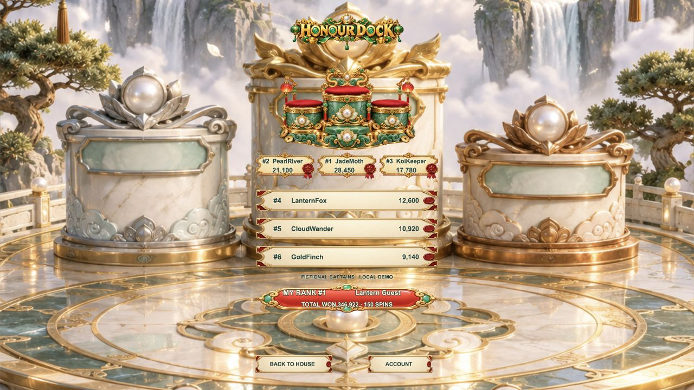
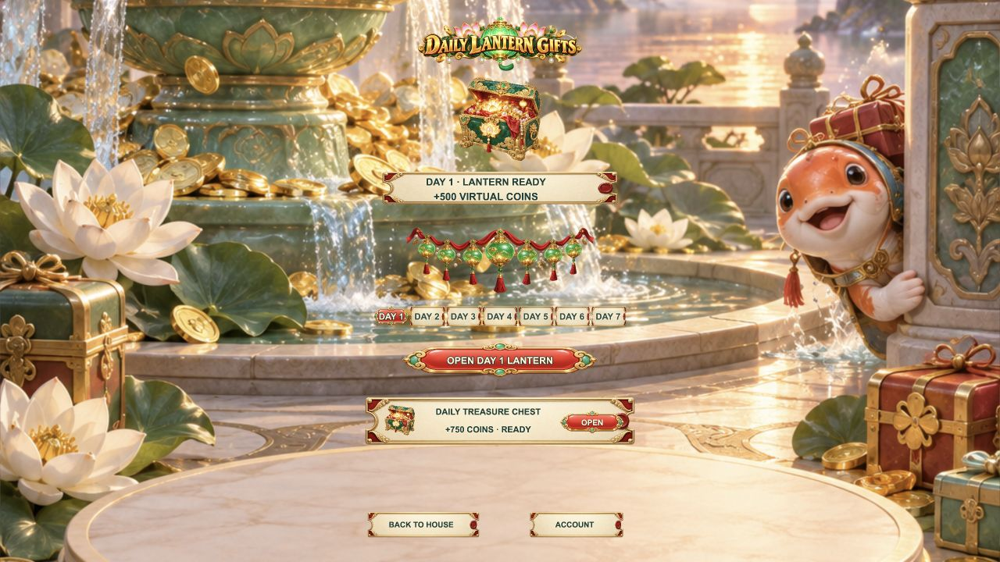

# F33 · Fortune Lantern House v2.0.0

A rebuilt, image-led Cocos Creator 3.8.8 mobile slot template. This is not a reskin of the earlier Golden Encore prototype: it uses a floating lantern treasury world, a three-lane choice feature, persistent lantern meters, four 5×3 win patterns (row, lotus path, scatter ingots, dragon columns), and distinct scene art for every major surface and machine.

All visible art is generated through the local CC Switch image generation bridge and stored under `assets/resources/art/`. Text remains live Cocos labels for legibility and localization.

## QA commands

```bash
npm run typecheck
npm test
/Applications/Cocos/Creator/3.8.8/CocosCreator.app/Contents/MacOS/CocosCreator \
  --project "$PWD" \
  --build "configPath=$PWD/tools/web-mobile-build.json" \
  --exit
```

The build is a local virtual-coin demo. It must not be represented as a backend-authoritative wallet, Apple Sign In integration, or real-money store.

## Music and fortune-beckoning keepers

All four hall exhibits and four cabinet scenes now articulate their embedded generated keepers: the otter presents its coin, the rabbit curls its paw with an ear follow-through, the fox makes two offering lifts, and the dragon sweeps its treasure claw with a tail response. Local head/paw/detail regions move smoothly within the original scene texture; the cabinet, ground-contact points, reel apertures and control sockets do not sway. Three pooled generated coins and a generated palm reflection follow each keeper's paw. Cabinet character taps greet only; dragging or tapping a reel cannot start a spin. Entry, actual spin and awarded tiers cue the same owned gesture without stacking tracks. Prize overlays suspend the underlying rig, background events reset it, and reduced-motion mode creates no keeper deformation material or coin pool. This pass reuses the original CC Switch-generated scenes; it does not introduce code-drawn character art or new image-generation claims.

Actual browser QA covered 320×568, 390×844 and 430×932 layouts, rapid hall swipes, all four cabinet greetings, reduced motion and the first-ten-spin sequence. See `docs/screenshots/keeper-beckon-390.gif`, `docs/screenshots/keeper-responsive-audit.jpg` and `docs/keeper-spin-regression.json`. Browser renders do not certify physical-device frame rates or touch usability.

The house theme is an original, cheerful 112 BPM instrumental loop synthesized by `python3 tools/compose_lantern_music.py` (no third-party samples). Browser playback begins only after a user gesture, continues across rooms, and pauses while the app is backgrounded. Account → **SOUND · ON/OFF** remembers the local preference; there is no required audio for gameplay.

## Four treasure rooms

| Room | Result rule | Artwork |
| --- | --- | --- |
| Jade Ferry | Chosen-row lantern run (3/4/5) | Jade ferry cabinet |
| Pearl Garden | Chosen zigzag lotus-path pearl run (3/4/5) | Pink lotus-and-pearl conservatory |
| Ember Foundry | Ingots anywhere on the board (6/9/12) | Coral-and-gold foundry |
| Celestial Vault | Consecutive dragon-bearing columns (3/4/5) | Blue-and-gold dragon treasury |

Ordinary, big and super wins are distinct; unmatched spins pay zero. A separate big win is guaranteed within the first five spins and a super win within the first ten on this local demo save. Generated art via local CC Switch. These rooms have distinct result patterns, but still share a 5×3 topology and a common presentation controller. They are **not** feature-equivalent to F20’s four independent machines.

## Current quality boundary

A new four-room Treasure Atlas provides persistent 3/10/25-spin milestones and one-time virtual-coin claims. It was exercised in a real browser for claim, balance, ledger and next-goal state. See `docs/QUALITY_AUDIT.md` for the visual comparison, observed defects and remaining release gaps. This project has **not** reached the visual/mechanical parity of F20 or S05, and it is not an App Store-ready product.

The latest local CC Switch art pass replaces the login backdrop with a full-height integrated entry console and replaces four floating shop cards with a single connected merchant cabinet. The observed 320×568 and 390×844 browser renders are in `docs/screenshots/login-foyer-final-*` and `docs/screenshots/store-cabinet-final-*`. This is one targeted quality improvement, not an assertion that F33 has reached F20/S05 parity.

## Language and regression status (2026-09-29)

English, simplified/traditional Chinese, Japanese and Korean can be selected on the entry console or Account page and are persisted independently of the local demo save. A device-local inbox with one-time virtual-coin attachments, and localized Privacy/Terms/Help **demo information**, have been added. See `docs/QUALITY_AUDIT.md` for a feature-by-feature F32 comparison. **Full F32 parity is not yet achieved**: account/Apple authentication, StoreKit, real rankings, release audio/device tuning, and localization of English text embedded in generated artwork remain open.

## Spin pacing and win stage (2026-09-29)

Updated September 30: this **local virtual-coin demo** uses a 42.4% base board-hit rate (34% ordinary, 8% big, 0.4% super), with 1×/4×/8× stake base awards. Ordinary is a refund-sized result; any final payout greater than the stake receives the BIG presentation unless its board is SUPER. Room-specific features add their documented bonuses; Pearl Garden can upgrade a held result, so its final tier distribution differs. First-five big and first-ten super are separate onboarding guarantees and temporarily change the distribution. A fixed-seed 100,000-spin-per-room regression checks final payouts and hit rates; it is not a certification, regulated RNG audit, or real-money return promise. The 5×3 result is reserved and the stake debited before reel motion; payout is persisted once at settle, while the visible win count and HUD reveal follow the stage timing. The reward-stage art already contains its physical treasure vessel, so the presentation animates a keeper and generated coin/light layers instead of placing a second chest on top.

## Probability correction and post-onboarding audit (2026-10-12)

The local virtual-coin math was audited after a report that the win probabilities seemed wrong. The base draw is intentionally unchanged: **57.6% no match, 34% ordinary refund (1× stake), 8% BIG board (4×), and 0.4% SUPER board (8×)**. The important correction is that the first-five BIG and first-ten SUPER promises are now bounded to the exact fifth/tenth new-player spins; a stale save with missing flags no longer receives overdue guarantees after spin 10. The saved guarantee is also parsed strictly as booleans.

A final award can still present as BIG when a room feature makes the payout exceed the stake, so the visible BIG rate is higher than the base board BIG rate by design. With the current feature rules, a deterministic 1,000,000-round post-onboarding audit per room measured paid-tier rates of **Jade 31.384% refund / 12.301% BIG / 0.409% SUPER, Pearl 31.947% / 9.427% / 1.009%, Ember 30.557% / 15.235% / 0.390%, and Celestial 30.130% / 11.772% / 0.401%**. The corresponding payout/stake ratios were **0.865082 / 0.777274 / 0.860365 / 0.927676**. These are reproducible local-demo samples, not regulated RNG or real-money RTP certification. The audit also verifies debit-before-spin, one settlement, mixed-room onboarding, JSON reloads, and no overdue post-onboarding guarantees. Source and reports: `tools/probability-audit.ts`, `docs/probability-regression.json`, and `docs/probability-built-regression.json`. The source and actual emitted-math reports match exactly apart from their implementation labels. The old-save defect was reproduced with isolated data; the user’s actual save was not inspected.

## Reward audio feedback (2026-09-30)

Eight original PCM clips (`python3 tools/compose_reward_sounds.py`) provide separate ordinary/big/super fanfares, gift opening, coin-shower foley, throttled count ticks, a counting-complete chime, and collection confirmation. The score enters with the award marquee; coin sounds follow the actual particle waves and the final chime follows the amount's last tick. Background music ducks smoothly from 0.28 to 0.13 during the show, then returns on collection.

Four owned reward voices are reused. Collect/skip, redraw, backgrounding and destruction cancel pending reward cues and stop their audio; collection confirmation has its own voice so it is not cut off by a redraw. The account SOUND preference controls music, clicks and rewards together. Re-enabling sound does not replay past awards. Reduced-motion mode keeps the tier/claim feedback without playing sounds for suppressed coin particles. All audio is optional and does not alter stake debit, payout settlement or onboarding guarantees.

`npm test` includes controller/cancellation tests, counter-rate checks and PCM/meta validation. Browser QA covered real first-ten spins, daily/chest/mail claims, mute/unmute, early collection and simulated engine hide/show events; 320×568 reduced-motion and 390×844 full-motion states were inspected. This is not a real-iPhone speaker, latency or mix certification. Creator still returns 36 after reporting Build Finished, while the generated preview runs.

## Keeper clearance pass (2026-09-30)

Generated cabinet wordmarks now register on the side opposite each keeper; a slim generated subtitle rail and source-registered feature-meter height prevent captions from covering the paws or each other on short screens. Hall reflections follow the side shrines, plinth and floor rather than sweeping across the keeper. Offering coins approach below/outside the paw and fade before the face/fingers. Award coins and light use an independent soft-opacity gate following the actual breathing backdrop transform; their native animation and the existing audio are preserved. The SUPER headline/copy fits into the open central dragon column, and the BIG collect button sits below the entire otter. No new artwork was drawn/generated and no game-economy changes were made.

Typecheck and the full test suite pass. Final browser renders covered all four cabinets at 320×568, 390×844 and 430×932, all three reward tiers, and 320×568 reduced motion. A fresh real ten-spin run retained debit-before-spin and single settlement, with BIG on spin 5 and SUPER on spin 10. See `docs/keeper-clearance-regression.json`, `docs/screenshots/keeper-clearance-layouts.jpg` and `docs/screenshots/keeper-clearance-awards.jpg`. The test-owned Chrome was explicitly closed. Creator still reports Build Finished then exits 36; release-build and physical-device verification remain open.

## Independent room artwork and integrated awards (2026-09-30)

Four separate CC Switch-generated six-symbol sets replace the shared reel artwork. Jade Ferry uses jade lantern/koi/wheel/ingot/chest/otter; Pearl Garden uses pearl bell/fan/lotus/purse/box/rabbit; Ember Foundry uses forge lamp/key/hammer/ingots/safe/fox; Celestial Vault uses blue-gold lantern/compass/orb/ingot/chest/dragon. These are 24 distinct RGBA bitmaps, not recolored or renamed copies. Connected-component extraction, matte cleanup and uniform padding preserve the generated outlines. The clipped dragon-room lantern was regenerated with a safe margin.

Logical symbol IDs and four existing result rules are retained. Initial, moving, held-respin and settled symbols all resolve through `ThemeArt.ts`; room-primary rule/meter icons follow the same mapping. BIG/SUPER scenes now belong to the **room**, not the tier, so the dragon never receives the rabbit tableau. The generated title, localized caption, amount and claim button attach to the same full-scene backdrop. A timed fade, vessel light, count-up and staggered generated-coin fountains replace the overshooting sticker entrance. Ordinary refunds remain briefly in the physical cabinet. Existing audio/music is preserved, not newly replaced in this pass.

Typecheck and the complete test suite pass. Browser viewport checks cover all four cabinets at 320×568, 390×844 and 430×932. A fresh real touch-input ten-spin run covered all four room entrances, correct moving/settled sprites, debit before reel motion, BIG on spin 5, SUPER on spin 10 and single settlement. Short-screen SUPER diagnostics and reduced-motion checks preserve readable copy and protected keeper regions; a delayed-resize guard prevents stale layout work from cancelling a newly opened award. See `docs/theme-art-regression.json`, `docs/screenshots/theme-art-four-cabinets.jpg` and `docs/screenshots/theme-art-four-awards.jpg`.

Fixed-seed 100,000 post-onboarding rounds per room returned sample payout/stake ratios of 0.86367 / 0.77444 / 0.86082 / 0.93013. They include room features and are demo regression samples, **not certified RTP, regulated probability or real-money promises**. Creator reports Build Finished but still exits 36. Physical-device performance and release-build certification remain open.

## Merchant shop alignment pass (2026-09-30)

The shop's four product titles, coin quantities, descriptions and claim captions now register on their corresponding source-art niches/signs instead of unrelated screen offsets. The generated cabinet keeps its square aspect ratio; the wallet handles long balances without entering the right-side ornament. Existing generated artwork, four pack amounts and the free demo-coin flow are preserved.

Final screenshots cover three mobile viewports × five languages. Real touch checks confirm the four pack claims, duplicate-input protection, single credit on collection and persisted balance. Typecheck and the full tests pass, including `tools/shop-layout-test.ts`. Evidence: `docs/shop-text-regression.json` and `docs/screenshots/shop-text-final-*.{jpg,png}`. Test-owned Chrome is closed; the existing preview server remains available. Creator still reports Build Finished then exits 36; this pass does not claim release-build, physical-device, accessibility or real-payment certification.

## 2026-10-12 delivery and runtime screenshots

Current delivery: Fortune Lantern House, Creator 3.8.8. Three-tier cabinet awards retain theme-specific orchestral audio, coin fountains and automatic dismissal (BIG approximately 7.32 seconds; SUPER approximately 9.12 seconds, including exit fade). Final amounts hold for readability; manual dismissal remains available.

These are actual web-mobile runtime screenshots, not design mockups. Existing guest progress was preserved during capture.

| Lobby | Cabinet |
|---|---|
|  |  |
| Login | Shop |
|  |  |
| Ranking and separate personal rank | Daily gifts |
|  |  |

Validation: npm test, npm run typecheck, npm run typecheck:math passed. Creator logged export completion; its macOS command-line teardown returned exit 36. The exported web build was exercised in the browser, but a clean native release/export is not claimed. See [latest optimization review](docs/OPTIMIZATION_REVIEW_20261012.md).

This remains a local virtual-coin template, not real-money gambling. Native authentication, StoreKit, server authority, signing and App Store approval require separate integration and validation.
