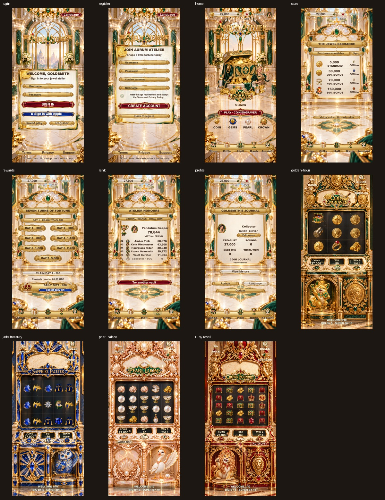

# F34 · Aurum Atelier

[Current Git delivery screenshots · 2026-10-09](docs/screenshots/f34-git-delivery-20261009/README.md)

A Cocos Creator 3.8.8 virtual-coin slot game set in an original goldsmith's atelier. Four cabinets have separately commissioned art, symbol sheets, controls, feature rules and mode arrivals. The browser build is a local preview of the Cocos game, not a separately implemented H5 game.

| Cabinet | Base game | Feature |
|---|---|---|
| Coin Engraver | 3 × 3, five left-to-right paylines | Three minting dies open a three-reset hold-and-spin Mint Reserve; collected values pay once. |
| Sapphire Faceter | 5 × 3, 243 ways | A Wild makes its row and reel Wild for one re-evaluation; only the increase pays. |
| Pearl Loom | 5 × 4 changing ways | Three Scatters grant five free spins; wins tumble for up to three additional drops with 2×/3×/4× progression. |
| Crown Foundry | 5 × 5, qualifying 8+ symbol counts | A Wild expands its reel for one re-evaluation; only the increase pays. |

Each cabinet and its surrounding workshop room share a newly commissioned environment painting (`art-source/regenerate_guardian_cabinets_ccswitch.py`). Its carved lower alcove reserves a real plinth for a separate fortune guardian, with a solid shoulder and independently moving paw or wing (`art-source/prepare_guardian_motion.py`). Pearl/Ruby now use complete newly commissioned characters, with each body and moving limb extracted from its own master (`art-source/prepare_guardian_coherent.py`); the pearl gift sits independently on the plinth. The cabinet glass, frame, controls and room retain one perspective and material palette. The original synthesized instrumental score (`art-source/compose_audio.py`) uses upbeat major-key casino celebration throughout: 116 BPM piano/brass swing in the salon, 124 BPM coin-chime shuffle for Coin Engraver, 118 BPM guitar/vibes Latin swing for Sapphire Faceter, 114 BPM piano/harp gala swing for Pearl Loom, and a 126 BPM royal brass parade for Crown Foundry. All four cabinets have their own BIG/SUPER/MEGA/EPIC counting and resolution cues; the exact amount reveal starts the ending, and early collection fades it with the scene. Button/reel, ordinary and feature cues remain. The sound switch mutes effects and music; backgrounding pauses playback. Browser music may begin after the first user gesture because autoplay is restricted.

The game includes initial and four mode-specific loading scenes, local guest/account entry and eligibility consent, legal and support pages, a swipeable hall, rules, four animated cabinets, spin/auto/bet controls, ordinary and tiered award presentations, audio settings, daily rewards, clearly labelled virtual-friend ranking, portrait selection, account data, and a store that shows unavailability when purchases are not connected. English is the default language. Virtual coins have no cash value.

Current preview: **f34-whole-game-polish-v6-20261009**. Open [the salon](http://127.0.0.1:6035/?debug=1&screen=home&v=f34-whole-game-polish-v6-20261009) or [Crown Foundry](http://127.0.0.1:6035/?debug=1&screen=game&game=ruby-revel&v=f34-whole-game-polish-v6-20261009). See the [whole-game changes and verification](docs/whole-game-polish-20261009.md) and [current screenshots, recordings and reports](docs/screenshots/f34-whole-game-polish-v6-20261009/README.md).

## Build and checks

Open this folder in Cocos Creator 3.8.8. Run `npm ci`, `npm test`, and `npm run typecheck` after the editor creates its temporary type configuration. Build `web-mobile` with `tools/web-mobile-release-build.json` for the Cocos browser preview; native build settings are separate.

## Current evidence

[Full v6 change and verification report](docs/whole-game-polish-20261009.md) · [Runtime reports and continuous recordings](docs/screenshots/f34-whole-game-polish-v6-20261009/README.md) · [Fresh delivery screenshots](docs/screenshots/f34-git-delivery-20261009/README.md)

The repository includes current project source, runtime assets, art-generation/processing scripts, selected art masters and current review evidence. Superseded local screenshot iterations, dependencies, build outputs and editor caches are excluded.

Apple sign-in and purchases require real platform integration and are accurately unavailable in this local preview. Browser checks are not native-device or App Store acceptance. Small-phone secondary text and untranslated editorial copy still require final product review; see the report for boundaries.
