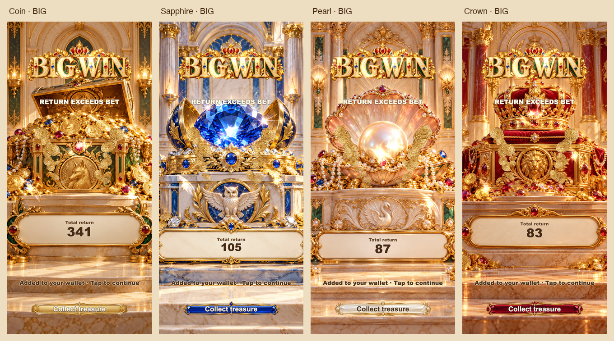

# F34 · Gilded Crescendo

2026-09-30，`f34-gilded-crescendo-20260930` 当前构建截图与连续录制。

## 最终画面

- [四主题 BIG 对照](four-awards.jpg)：390 × 844，铸币 / 蓝宝石 / 珍珠 / 王冠。
- [小屏 SUPER、MEGA、EPIC](small-screen-tiers.jpg)：320 × 568，高奖级使用隔离测试 fixture。
- [Pearl 入场、揭晓与退出连续抽帧](award-transition-sequence.jpg)。
- [Pearl BIG 揭晓高潮](pearl-palace-big-climax.png)。
- [Crown EPIC 自动演出高潮](crown-epic-automatic-climax.png)：隔离高奖级测试。
- [降低动态模式](pearl-reduced-320x568.png)。

## 连续录制：含实际游戏声音

Canvas VP8 视频与游戏 WebAudio Opus 音频由同一个 MediaRecorder 时钟录制。短片从完整录制直接裁剪，未添加外部音轨。

- [Pearl BIG 演出短片](motion/pearl-award-transition-with-audio.webm)：完整进退场和揭晓；确定性 seed 27 的引擎结算，未使用高奖级 fixture。
- [Pearl 完整流程](motion/pearl-complete-with-audio.webm)：待机 → 旋转 → BIG 演出 → 自动恢复柜机 → 返回大厅。下注 80，总返还 87。
- [Crown EPIC 演出短片](motion/crown-epic-award-with-audio.webm)：隔离高奖级 fixture，用于查看最高档高潮。
- [Crown EPIC 完整流程](motion/crown-epic-complete-with-audio.webm)：seed 2 的隔离 fixture；下注 80，总返还 12,083。

这些确定性录制展示动画和操作通路，不能作为自然中奖频率证据。

## 验证数据

- [7 案例运行数据](runtime-qa.json)：四主题 BIG（390 × 844），Coin SUPER / Sapphire MEGA / Crown EPIC（320 × 568）；包含入场、揭晓采样、稳定文字、快速退出、结算、声音、后台恢复与清理。
- [Pearl 录制时间标记](motion/pearl-complete-with-audio.json)。
- [Crown EPIC 录制时间标记](motion/crown-epic-complete-with-audio.json)。
- [降低动态检查](motion/reduced-check.json)。
- [实现与验收记录](../../gilded-crescendo-20260930.md)。

7 案例均通过，浏览器错误为空。截图检查构图，连续录制检查完整过程；本地预览不代替手机实机或 App Store 发布验收。
