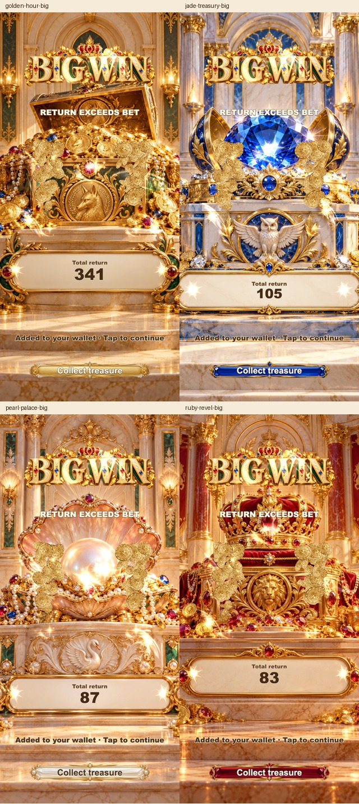

# F34 · 分层财富庆典

2026-09-30，预览版本 `f34-grand-wealth-20260930`。四台柜机的 BIG、SUPER、MEGA、EPIC 增加三层金币、财宝光扇、宝石反光与双段揭晓高潮，音乐沿用本轮之前的 44 条喜庆配乐和音效。

## 当前画面

- [四主题 BIG 对照](four-awards.jpg)：390 × 844，铸币 / 蓝宝石 / 珍珠 / 王冠。
- [小屏 SUPER、MEGA、EPIC](small-screen-tiers.jpg)：320 × 568，高奖级使用隔离测试 fixture。
- [Pearl BIG 金额揭晓](pearl-palace-big-climax.png)。
- [Crown EPIC 自动演出高潮](crown-epic-automatic-climax.png)：隔离高奖级测试。
- [降低动态模式](pearl-reduced-320x568.png)。

## 连续录制：实际游戏声音

Canvas VP8 视频与游戏 WebAudio Opus 音频由同一个 MediaRecorder 时钟录制，没有加入外部音轨。完整录制期间不额外调用截图，以免截图阻塞浏览器合成；高潮截图由独立运行检查保存。

- [Pearl BIG 完整流程](motion/pearl-complete-with-audio.webm)：待机 → 旋转 → 自动计数 → 两波揭晓 → 退出 → 返回大厅，约 23.65 秒。真实引擎 seed 27，下注 80、总返还 87。
- [Crown EPIC 完整流程](motion/crown-epic-complete-with-audio.webm)：最高档完整流程，约 27.76 秒。隔离测试奖级 fixture，下注 80、总返还 12,083。
- [Pearl 连续过程抽帧](pearl-complete-sequence.jpg)。
- [Crown 连续过程抽帧](crown-complete-sequence.jpg)。

两份录制在隔离 QA 上下文进行，没有操作用户真实存档。seed 与 fixture 用于验证动画和结算通路，不能作为自然中奖频率证据。

## 验证结果

类型检查、演出边界及分档测试、最终 Cocos 构建与 7 案例运行检查通过。运行覆盖四主题 BIG（390 × 844）和 SUPER / MEGA / EPIC（320 × 568）。金额与标题位置稳定，旋转金币不侵入说明、金额或按钮；两波一次性抛洒在 2.5 秒停留内完成。提前揭晓、快速双击、自动退出、后续旋转、静音、后台恢复及返回大厅均已检查，浏览器错误为空。

| 最终录制 | RAF 样本 | 中位帧间隔 | 95% 分位 | 超过 50 ms 的间隔 |
|---|---:|---:|---:|---:|
| Pearl BIG | 1420 | 16.7 ms | 16.8 ms | 0 |
| Crown EPIC | 1667 | 16.7 ms | 16.7 ms | 0 |

这些是本机桌面帧时钟采样，不代表移动实机性能。已查看完整过程的连续抽帧和最终构图；手机实机及原生生命周期验收仍需单独进行。

- [实现与完整验收记录](../../grand-wealth-20260930.md)。
- [类型检查日志](typecheck.log)、[演出测试日志](presentation-test.log)。
- [构建产物核实](build-audit.json)、[媒体时长与音轨核实](media-audit.json)。
- [7 案例数据](runtime-qa.json)。
- [Pearl 时间标记及帧时钟](motion/pearl-complete-with-audio.json)。
- [Crown 时间标记及帧时钟](motion/crown-epic-complete-with-audio.json)。
- [降低动态独立检查](motion/reduced-check.json)。

本轮完成桌面 Cocos 预览的演出修改与检查；不代表手机真机或 App Store 发布验收完成。
