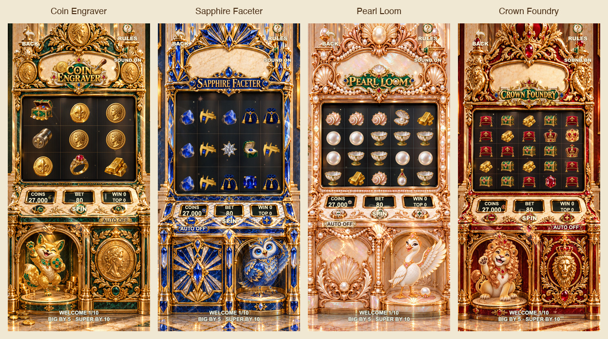

# F34 当前画面与验收证据 · whole-game-v6 · 2026-10-09

当前构建：`f34-whole-game-polish-v6-20261009`，Cocos Creator 3.8.8。本目录对应全界面打磨后的版本；[修改与验证记录](../../whole-game-polish-20261009.md) 说明完整范围与限制。

## 最终主画面

柜机画廊由下表中的四张当前截图等比缩小排版，没有改变游戏画面。PNG 为原始截图；文件名中的 390×844/320×568 为浏览器视口，DPR 2。

| 页面 | 390×844 | 320×568 |
|---|---|---|
| 大厅 | [截图](after/home-390x844.png) | [截图](after/home-320x568.png) |
| 登录 | [截图](after/login-390x844.png) | [截图](after/login-320x568.png) |
| 注册 | [截图](after/register-390x844.png) | [截图](after/register-320x568.png) |
| 商店 | [截图](after/store-390x844.png) | [截图](after/store-320x568.png) |
| 奖励 | [截图](after/rewards-390x844.png) | [截图](after/rewards-320x568.png) |
| 排行 | [截图](after/rank-390x844.png) | [截图](after/rank-320x568.png) |
| 账户 | [截图](after/profile-390x844.png) | [截图](after/profile-320x568.png) |
| Coin Engraver | [截图](after/golden-hour-390x844.png) | [截图](after/golden-hour-320x568.png) |
| Sapphire Faceter | [截图](after/jade-treasury-390x844.png) | [截图](after/jade-treasury-320x568.png) |
| Pearl Loom | [截图](after/pearl-palace-390x844.png) | [截图](after/pearl-palace-320x568.png) |
| Crown Foundry | [截图](after/ruby-revel-390x844.png) | [截图](after/ruby-revel-320x568.png) |

## 加载、弹窗与语言

- 四模式专属加载构图：[Coin](loading/golden-hour-390x844.png)、[Sapphire](loading/jade-treasury-390x844.png)、[Pearl](loading/pearl-palace-390x844.png)、[Crown](loading/ruby-revel-390x844.png)。截图固定为 66% 测试进度，用于构图检查；不表示真实资源测速。实际失败后的 [恢复画面](operations/load-failure-390x844.png) 另有操作测试。
- 最新四模式规则：[Coin](dialogs/golden-hour-rules-390x844.png)、[Sapphire](dialogs/jade-treasury-rules-390x844.png)、[Pearl](dialogs/pearl-palace-rules-390x844.png)、[Crown](dialogs/ruby-revel-rules-390x844.png)。特色说明另存于 `dialogs/`，文件名包含 `features`。
- 账户与法律页示例：[昵称](dialogs/editNickname-390x844.png)、[头像](dialogs/avatars-390x844.png)、[邮箱](dialogs/mail-390x844.png)、[账户选项](dialogs/accountOptions-390x844.png)、[隐私](dialogs/legal-privacy-390x844.png)、[协议](dialogs/legal-terms-390x844.png)、[游客确认](dialogs/guestConsent-390x844.png)。小屏对应截图同在 `dialogs/`。
- 多语言代表截图：[简体中文注册](locales/zh-CN-register-320x568.png)、[繁体中文商店](locales/zh-TW-store-320x568.png)、[日语账户](locales/ja-profile-320x568.png)、[韩语注册](locales/ko-register-320x568.png)。五种语言的更多状态在视觉报告中记录，不是每种状态都保存截图。

## 旋转、演出与声音

- 四模式 BIG 高潮：[Coin](gameplay/golden-hour-big-climax.png)、[Sapphire](gameplay/jade-treasury-big-climax.png)、[Pearl](gameplay/pearl-palace-big-climax.png)、[Crown](gameplay/ruby-revel-big-climax.png)。小屏高阶奖：[SUPER](gameplay/golden-hour-super-climax.png)、[MEGA](gameplay/jade-treasury-mega-climax.png)、[EPIC](gameplay/ruby-revel-epic-climax.png)。
- [当前 Pearl 连续视频](gameplay/motion/pearl-live-video.webm)，约 36 秒，包含实际 Cocos 旋转、大奖揭幕与计数、退出、普通/未中奖跟进及恢复。
- [独立捕获的游戏音频](gameplay/motion/pearl-live-audio.webm)。视频和音频分开保存，未合成为同步媒体；不是使用旧版配乐给视频后配。

录制与玩法测试使用一次性 context 中的确定性结果，演出通过实际结算流程触发，不修改生产随机概率，也不操作用户存档。静态截图验证位置、比例及可读性；连续视频用于观察时间过程，不能据此宣称手机实机丝滑。

## 结构化报告

| 报告 | 覆盖 |
|---|---|
| [visual-runtime-qa.json](visual-runtime-qa.json) | 112 个画面状态，两种手机视口、主页面、柜机、加载、弹窗、五语言；通过 |
| [dialog-refresh-qa.json](dialog-refresh-qa.json) | 390×844 最新 20 个弹窗状态；通过 |
| [operations/runtime-qa.json](operations/runtime-qa.json) | 18 组服务、账户及失败恢复操作；通过 |
| [gameplay/runtime-qa.json](gameplay/runtime-qa.json) | 七组旋转/奖级/音频/揭幕/清理检查；七例完成，页面错误为空 |
| [auto/runtime-qa.json](auto/runtime-qa.json) | 四模式各五项 AUTO 行为、扣款及结算核对；通过 |

`before/` 仅保存部分修改前的比较画面，没有完整基线验收报告；不能当作完整旧版审计。`dialogs/audit.json` 为较早的过程记录，最终状态以根目录两个视觉报告及上述当前截图为准。历史 v4/v5 角色证据和旧版音画记录保留在各自目录，没有冒充 v6 截图。

无整页滚动和标签越出视口只是边界检查，不能替代目视判断。320×568 部分次级说明约 8–11 CSS 像素；手机实机、正式 Apple 登录、StoreKit、签名、线上服务及 App Store 审核仍未验证。本轮没有 Git 提交或推送。
