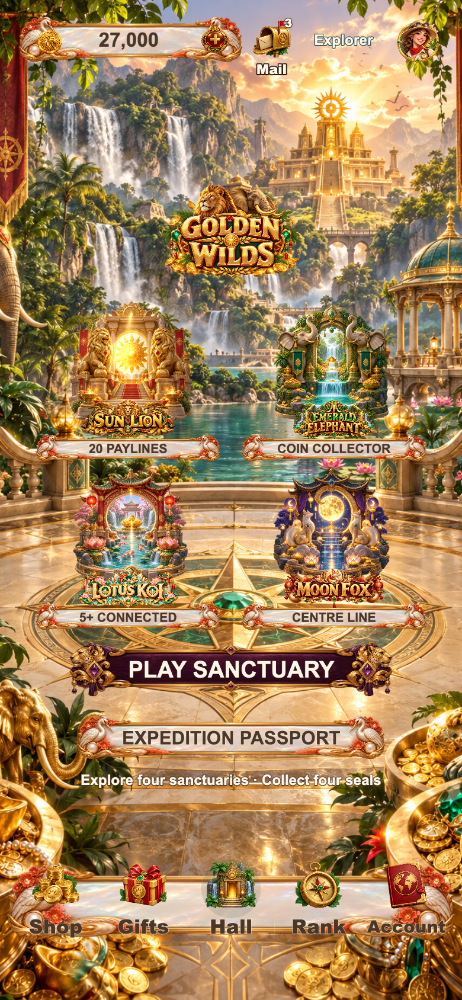
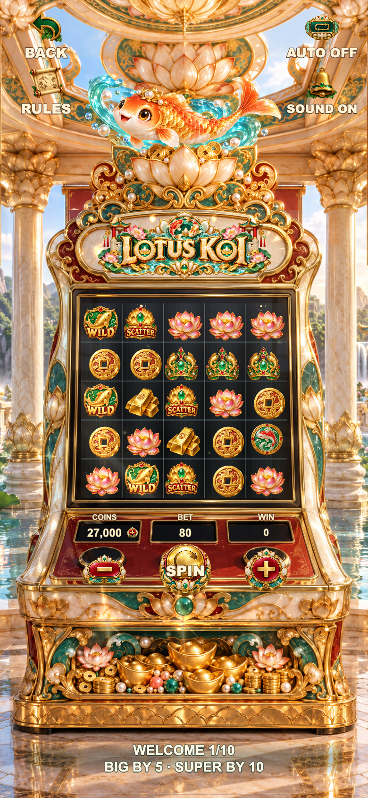

# F36 · Golden Wilds

Complete Cocos Creator **3.8.8** project: four traditional slot sanctuaries, original raster artwork, integrated cartoon guardians, themed loading, stage awards, warm festive audio and service pages. English is default; Simplified Chinese, Traditional Chinese, Japanese and Korean are included.

## Run

1. Import this directory in Creator 3.8.8 and run `npm ci`.
2. Open `assets/scenes/GoldenWilds.scene`.
3. Build using `tools/web-mobile-release-build.json`; run `python3 tools/preview_server.py --port 6036`. The Cocos development preview is at `http://127.0.0.1:6036/?debug=1`.

## Gameplay and completeness

| Sanctuary | Rule | Feature |
|---|---|---|
| Sun Lion | 5×3 · 20 paylines | Five free spins, sticky WILDs |
| Emerald Elephant | 5×3 · collector grid | Cash collection and hold respins |
| Lotus Koi | 5×5 · groups of five | Cascades at 1×, 2×, 4× |
| Moon Fox | 3×3 · centre line | Mystery reveal and three free spins |

Login, guest accounts, agreements, hall, mode arrivals, shop, daily gifts, sample ranking, profile, 16 avatars, languages, sound, mail, history and per-mode rules are included. Wallet debit and settlement are idempotent; pending local rounds recover safely. Real Apple login and StoreKit require configuration and device validation, and are not represented as connected services. Coins are virtual and cannot be redeemed for cash.

Awards use independent fitted winning-cell frames and a continuous cabinet stage. BIG means payout exceeds stake. SUPER, MEGA and EPIC remain. The account-wide first ten settled paid rounds include separately itemized welcome awards: at least 5× by round five and 10× by round ten.

## Current screenshots

[Hall and all four cabinets, two phone sizes](docs/screenshots/f36-git-final-20261010/README.md). Captured on 2026-10-10 from the final build.

| Sun Lion | Emerald Elephant |
|---|---|
|  |  |

| Lotus Koi | Moon Fox |
|---|---|
|  |  |

## Probability verification

[Audit and reproducible evidence](docs/probability-20261010/README.md). Six million natural rounds exclude welcome and forced QA results. Natural positive-payout frequency and RTP are different metrics.

| Mode | Positive payout | Payout greater than stake | Measured RTP |
|---|---:|---:|---:|
| Lion | 59.31% | 22.51% | 96.11% |
| Elephant | 48.03% | 37.45% | 96.16% |
| Koi | 57.68% | 31.37% | 95.99% |
| Fox | 7.35% | 7.35% | 95.77% |

The shared-WILD cluster duplicate-payment defect is fixed. Exact Fox analysis gives 95.981% RTP at bet 180. Simulation has sampling error; confidence intervals and limitations are in the audit.

## Validation and release boundary

`npm test`, `npm run typecheck`, math typecheck and Creator build passed. Four isolated accounts completed 48 real touch/crypto-RNG rounds, covering debit, settlement, repeat inputs, welcome guarantees, reload and interrupted-round recovery. Five-language rules were rendered and checked. [QA commands](tools/qa/README.md).

Native iPhone performance, signing, formal authentication, StoreKit, asset rights review and App Store review remain separate release checks. Local browser validation is not proof of commercial or platform approval.

[Product differences](docs/product-differences.md) · [Release checklist](docs/release-checklist.md) · [Asset provenance](docs/asset-provenance.md). Shipping image/audio assets, prompts, generator code and manifests are committed. Large raw commissions and historical recordings are retained locally and excluded from Git. Historical local QA documents may refer to those excluded captures.
