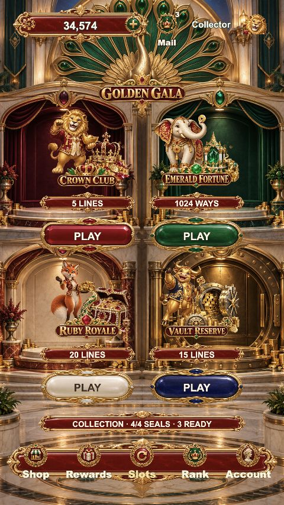
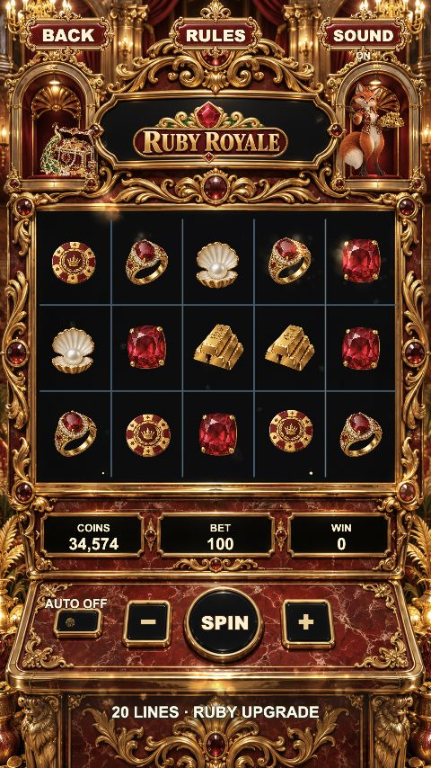
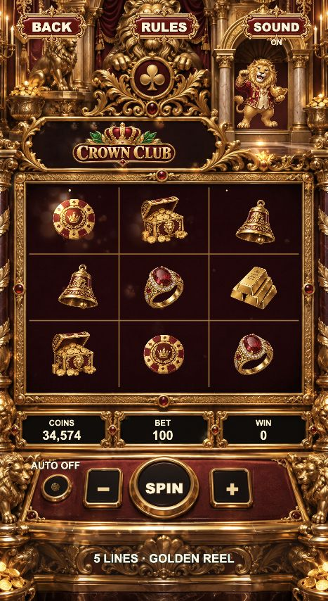
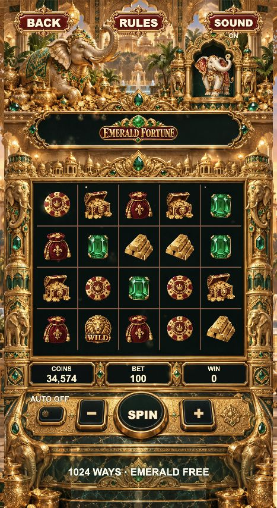
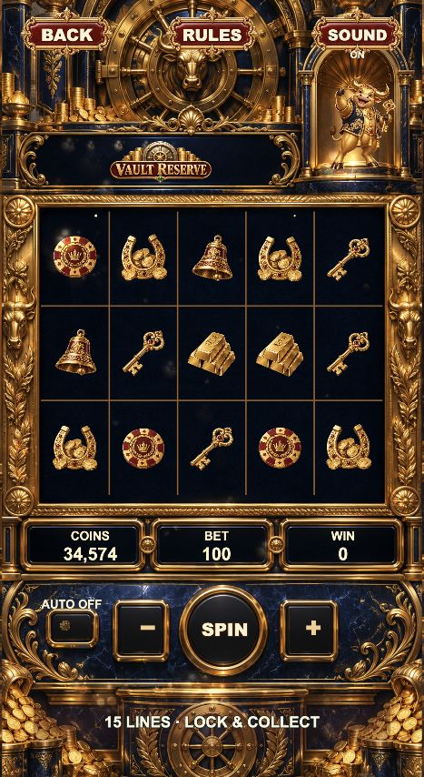

# F38 真实运行截图

均来自本地 Cocos Web 构建的浏览器截图，不是设计稿。尺寸为viewport，不是设备硬件认证。`force/showcase` 仅用于localhost演出验收。

## 2026-10-12 最新运行画面

本次提交的新截图直接取自运行中的最新版浏览器画面。大厅与红宝石柜机为本次推送前重新截取；其余三柜机为同日已验收画面。均为静态截图，不冒称动画录像、真机性能或主观音频验收。

### 大厅

### 红宝石皇家：新版狐狸、财宝壁龛与放大的动态标题

### 其他三款柜机
| 皇冠俱乐部 | 翡翠财富 | 金库珍藏 |
|---|---|---|
|  |  |  |

小屏／长屏布局证据：[320×568](../qa/fox-title-small-20261012.jpg)、[390×844](../qa/fox-title-tall-20261012.jpg)。

## 历史基线截图

以下保留初始版本的功能和适配验收证据；其中部分角色、美术及标题后来已更新，不作为当前版本的美术预览。

| 文件 | 内容 |
|---|---|
| overview.jpg | 大厅、翡翠柜机、调试SUPER奖三张真实截图等尺寸并排，未改画面内容 |
| login-390.jpg | 登录、入口、图标题、语言及条款位置 |
| lobby-390.jpg | 初始版大厅，四个直接PLAY及收藏总进度 |
| lobby-320.jpg | 紧凑手机大厅，PLAY与底栏不重叠 |
| lobby-430.jpg | 较宽手机大厅 |
| lobby-768.jpg | 平板大厅 |
| crown-club-390.jpg | 3×3皇冠俱乐部与柜机按键 |
| emerald-fortune-390.jpg | 5×4翡翠财富 |
| ruby-royale-390.jpg | 5×3红宝石皇家 |
| vault-reserve-390.jpg | 5×3金库珍藏 |
| ruby-royale-320.jpg | 紧凑手机柜机 |
| emerald-fortune-430.jpg | 较宽手机5×4玻璃及角色 |
| emerald-fortune-768.jpg | 修正横向条纹后的平板同相机扩景 |
| crown-club-768.jpg | 皇冠俱乐部平板同主题侧景 |
| ruby-royale-768.jpg | 红宝石皇家平板，无重复柜机边框 |
| vault-reserve-768.jpg | 金库珍藏平板与雕刻立柱 |
| ordinary-win-390.jpg | 调试普通奖78；细金框不遮挡三皇冠 |
| big-win-390.jpg | 调试BIG700；分级舞台与收取 |
| super-win-390.jpg | 调试SUPER2,500；宝箱金币舞台与金额 |
| shop-390.jpg | PREVIEW商店，不接真实购买 |
| rewards-390.jpg | 奖励页面 |
| rank-390.jpg | 本地排行，昵称为原始玩家昵称 |
| account-390.jpg | 账户页面及底栏 |
| rules-390.jpg | 分页规则及按钮文字位置 |

以上只陈述实际截图／交互；没有声称已录制所有动画、完成主观音乐试听或通过App Store审核。
