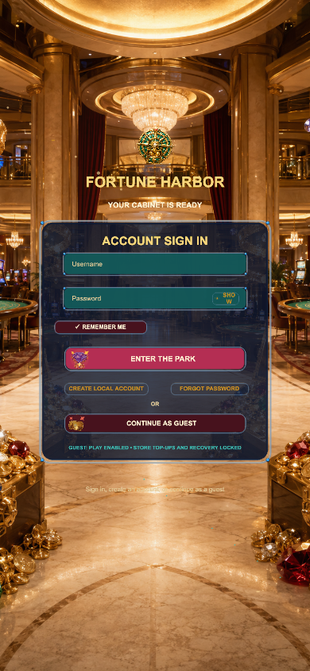
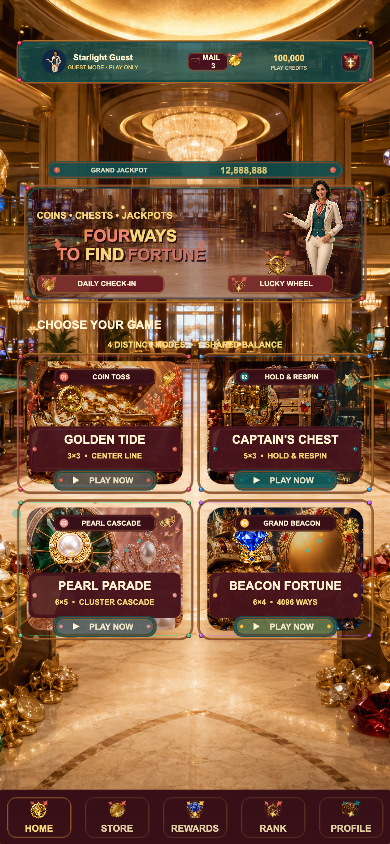
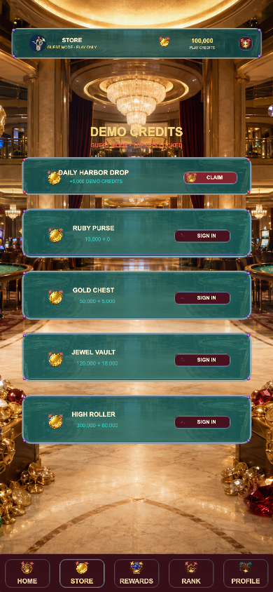
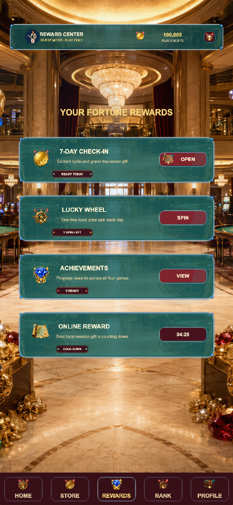
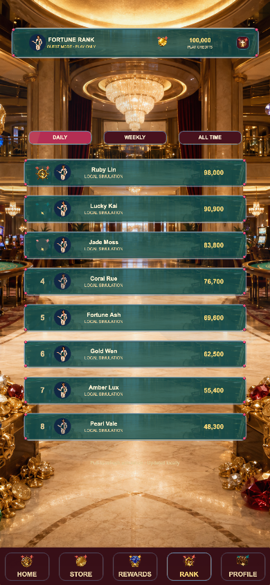
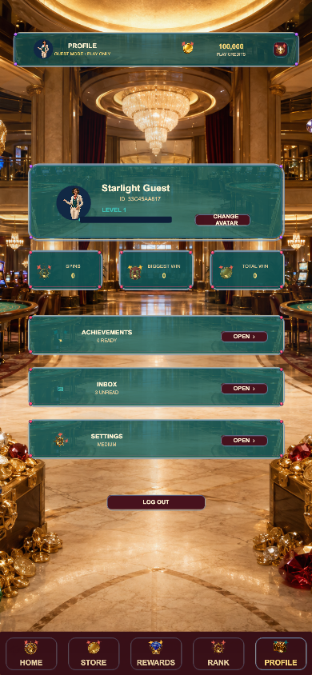
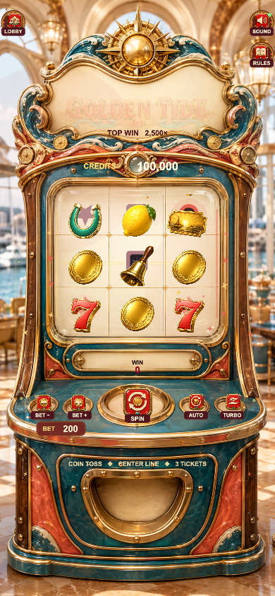
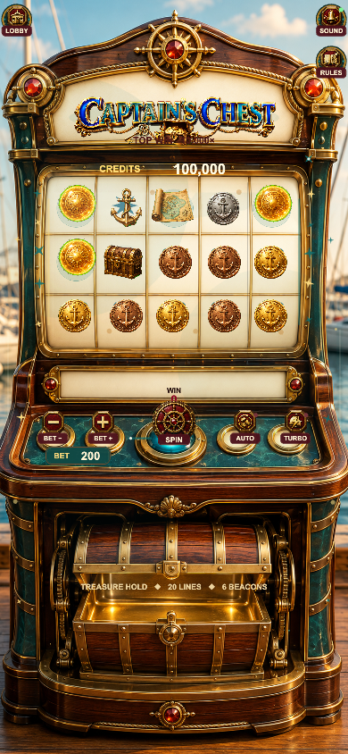
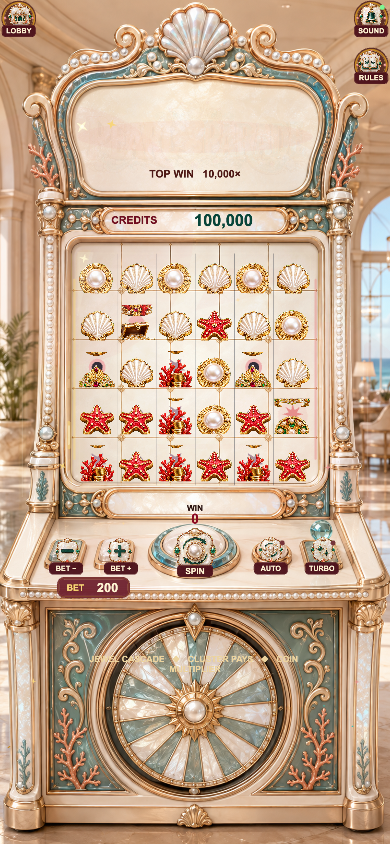
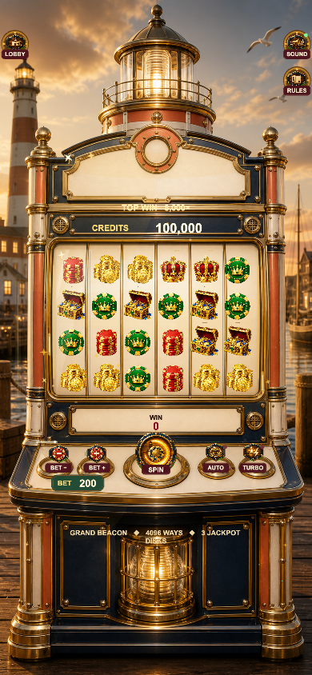

# FORTUNE HARBOR CASINO — F3 v1.0.0

## 运行截图

| 登录 | 大厅 |
| --- | --- |
|  |  |
| 商店 | 奖励 |
|  |  |
| 排行 | 账户 |
|  |  |
| Golden Tide | Captain's Chest |
|  |  |
| Pearl Parade | Lucky Lighthouse |
|  |  |

一套原创的 Cocos Creator 3.8.8 竖屏完整 Slots 世界。F3 以阳光财富港湾为统一世界观，使用同一太阳罗盘 Logo、主持人 Marina Vale、香槟黄铜、海玻璃绿、珊瑚红和真实柜机工艺，四款游戏拥有完全不同的数学结构与特色机构。

## 四个子游戏

- `GOLDEN TIDE`：3×3 单中线经典 Slots；三张港湾券触发金币抛掷 Bonus。
- `CAPTAIN'S CHEST`：5×3、20 条固定线；六枚 Coin Beacon 触发 Hold & Respin 与四档 Jackpot。
- `PEARL PARADE`：6×5 相邻 Cluster Pays；命中可进入最多三段递增倍率 Cascade。
- `BEACON FORTUNE`：6×4、4096 Ways；金币、筹码、珠宝与宝箱组成第四套财富主题，三枚 Jackpot Beacon 触发金库倍数 Bonus。

## 商业工程基线

- 数学与表现分离：安全随机源用于运行，固定种子用于回归。
- Spin 开始时冻结结果，Quick Stop、Turbo 与 Auto 只改变演出速度。
- 共享试玩钱包，大厅、账号、商店、奖励、规则、设置与本地恢复形成闭环。
- 1080×1920 设计分辨率；机柜约占画面高度 94%，屏幕、读数和五键控制均按每张正式机柜图独立测量。
- 逐轴停靠、机械回弹、胜利高亮、计数、金币流、分级 Big/Mega/Epic 演出与 reduced-motion 降级。
- `server/` 提供服务器权威 Spin、幂等结算、会话和 CSRF 参考实现。

## 验证

```bash
npm ci
npm run typecheck
npm run typecheck:server
npm test
npm run test:rtp
```

本地版本只使用无现金价值的试玩金币。任何真钱或可兑换价值版本都必须接入持牌服务器 RNG、独立数学实验室认证、年龄与地区限制、负责任博彩、KYC/AML 和支付票据验证。
