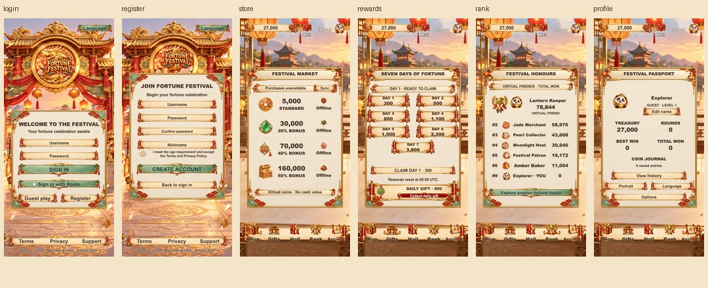

# F40 · 当前交付截图 · 2026-10-12

版本：`f40-gilded-selection-20261012`。以下画面均重新截取自本次交付版本的 Cocos 游戏预览，不复用早期迭代截图。

## 大厅与四台柜机

| 页面 | 390×844 | 320×568 |
| --- | --- | --- |
| 大厅 | [截图](home-390x844.png) | [截图](home-320x568.png) |
| Golden Phoenix | [截图](golden-phoenix-390x844.png) | [截图](golden-phoenix-320x568.png) |
| Jade Dragon | [截图](jade-dragon-390x844.png) | [截图](jade-dragon-320x568.png) |
| Pearl Qilin | [截图](pearl-qilin-390x844.png) | [截图](pearl-qilin-320x568.png) |
| Amber Panda | [截图](amber-panda-390x844.png) | [截图](amber-panda-320x568.png) |

[大厅选中对比与连续录像](../../qa/hall-selection-20261012/README.md)。柜机静态构图截图将吉祥物停在中性姿态，不能作为动作质量证明。

## 登录与辅助页面

| 页面 | 390×844 | 320×568 |
| --- | --- | --- |
| 登录 | [截图](services/login-390x844.png) | [截图](services/login-320x568.png) |
| 注册 | [截图](services/register-390x844.png) | [截图](services/register-320x568.png) |
| 商店 | [截图](services/store-390x844.png) | [截图](services/store-320x568.png) |
| 奖励 | [截图](services/rewards-390x844.png) | [截图](services/rewards-320x568.png) |
| 排行 | [截图](services/rank-390x844.png) | [截图](services/rank-320x568.png) |
| 账户 | [截图](services/profile-390x844.png) | [截图](services/profile-320x568.png) |

## 四模式加载

- [Golden Phoenix](services/loading-golden-phoenix-390x844.png)
- [Jade Dragon](services/loading-jade-dragon-390x844.png)
- [Pearl Qilin](services/loading-pearl-qilin-390x844.png)
- [Amber Panda](services/loading-amber-panda-390x844.png)

为了截取真实加载中途画面，隔离的检查浏览器将本项目图片请求延迟 1000 毫秒。这是截图条件，不是游戏中的强制加载时长。

## 豪华演出预览

- [Golden Phoenix](awards/golden-phoenix-epic-390x844.png)
- [Jade Dragon](awards/jade-dragon-epic-390x844.png)
- [Pearl Qilin](awards/pearl-qilin-epic-390x844.png)
- [Amber Panda](awards/amber-panda-epic-390x844.png)

演出截图使用隔离本地调试场景中的金额夹具，只验证演出构图与原柜机场景连续性，不证明自然中奖概率或真实余额结算。

## 检查与范围

- [大厅及柜机截图记录](layout-capture.json)：两种手机比例、10 张截图，未发现浏览器错误。
- [辅助页及真实加载截图记录](services/capture-audit.json)：16 张截图，辅助页面无整页滚动，未发现浏览器错误。
- [四台柜机演出截图记录](awards/capture-audit.json)：4 张当前演出预览。
- [交付检查摘要](delivery-checks.json)：完整 `npm test`、客户端类型检查、服务端类型检查通过。
- [发布检查日志](release-audit.log)：21/26 项通过，发布身份与法律配置、商品标识、原生接入及设备/生产验收仍待完成。

以上为桌面浏览器的手机尺寸模拟。Creator 报告导出完成，但返回 CLI 36 和 worker SIGTERM 诊断；运行中的导出已检查。真机、支付、正式服务与商店审核尚未验收。
