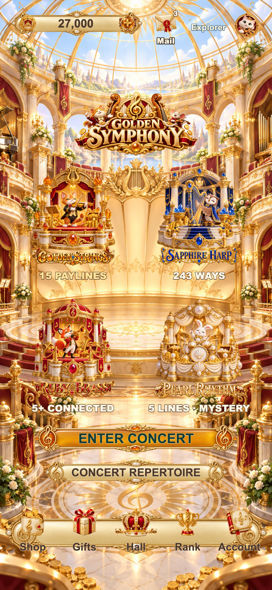

# F43 当前截图 · 2026-10-13

共47张 PNG，均保留捕获时的原始比例；手机截图使用2倍像素密度。截图检查构图、文字和裁剪；转轴、角色、光泽及演出节奏以[连续动画证据](../../qa/f43-final-20261013/motion/motion-audit.json)和[验收记录](../../validation-20261013.md)为准。

[捕获清单](capture-manifest.json)逐张记录构建、来源、时间、尺寸、SHA-256及fixture。最终预览为build10；四模式柜机在320/390/1366视口重新捕获，验证单一背景与自然房间延伸。辅助页、协议及先前分级演出保留其实际构建标签；本轮旋转/大奖/退出另有[连续录制](../../qa/f43-continuous-background-20261013/motion/motion-audit.json)，不把旧截图作为新背景的验证证据。

## 大厅与四台柜机

| 画面 | 390×844 | 320×568 |
|---|---|---|
| 黄金音乐大厅 | [查看](home-390x844.png) | [查看](home-320x568.png) |
| Golden Strings · 猫指挥 | [查看](golden-strings-390x844.png) | [查看](golden-strings-320x568.png) |
| Sapphire Harp · 猫头鹰竖琴师 | [查看](sapphire-harp-390x844.png) | [查看](sapphire-harp-320x568.png) |
| Ruby Brass · 狐狸铜管手 | [查看](ruby-brass-390x844.png) | [查看](ruby-brass-320x568.png) |
| Pearl Rhythm · 兔子鼓手 | [查看](pearl-rhythm-390x844.png) | [查看](pearl-rhythm-320x568.png) |

[大厅横向宽视口](home-1366x768.png)。柜机宽屏：[Golden Strings](golden-strings-1366x768.png) · [Sapphire Harp](sapphire-harp-1366x768.png) · [Ruby Brass](ruby-brass-1366x768.png) · [Pearl Rhythm](pearl-rhythm-1366x768.png)。构图用中立角色或 reduced motion；不据此证明动作自然。

## 登录与辅助页面

| 页面 | 当前截图 |
|---|---|
| 登录 | [390](login-390x844.png) · [320](login-320x568.png) |
| 注册 | [查看](register-390x844.png) |
| 商店 | [查看](store-390x844.png) |
| 奖励与签到 | [查看](rewards-390x844.png) |
| 示例排行 | [390](rank-390x844.png) · [320](rank-320x568.png) |
| 账户 | [查看](profile-390x844.png) |
| 邮箱 | [查看](mail-390x844.png) |
| 头像 | [查看](avatars-390x844.png) |
| 永久三幕乐章册 | [查看](journey-390x844.png) |
| 旋转记录 | [查看](history-with-entry-390x844.png) |

## 每个模式的加载与规则

| 模式 | 专属加载 | 规则首页 |
|---|---|---|
| Golden Strings | [查看](loading-golden-strings-390x844.png) | [查看](rules-golden-strings-390x844.png) |
| Sapphire Harp | [查看](loading-sapphire-harp-390x844.png) | [查看](rules-sapphire-harp-390x844.png) |
| Ruby Brass | [查看](loading-ruby-brass-390x844.png) | [查看](rules-ruby-brass-390x844.png) |
| Pearl Rhythm | [查看](loading-pearl-rhythm-390x844.png) | [查看](rules-pearl-rhythm-390x844.png) |

加载截图仅在独立QA中延迟真实资源请求以捕获过程，产品没有为截图设置假进度。

## 奖励演出

| 模式 | EPIC |
|---|---|
| Golden Strings | [查看](golden-strings-epic-390x844.png) |
| Sapphire Harp | [查看](sapphire-harp-epic-390x844.png) |
| Ruby Brass | [查看](ruby-brass-epic-390x844.png) |
| Pearl Rhythm | [查看](pearl-rhythm-epic-390x844.png) |

Golden Strings 分级：[BIG](golden-strings-big-390x844.png)、[SUPER](golden-strings-super-390x844.png)、[MEGA](golden-strings-mega-390x844.png)。其中SUPER已更新为build10的正常时长实际旋转/结算fixture；四模式本轮演出截图见[运行证据](../../qa/f43-continuous-background-20261013/motion/)。普通奖：[Golden](golden-strings-ordinary.png)、[Sapphire](sapphire-harp-ordinary.png)。

先前BIG/MEGA/EPIC截图使用演出fixture，揭示停留延长至60秒便于截图，不能作为自然中奖概率或真实到账证据。build10 SUPER另走实际扣款及结算，但强制分级仍不能证明自然中奖概率。普通奖使用真实 evaluator 的种子结果。实际扣款/结算、演出退出与输入恢复另行检查，详见验收记录。

## 条款、隐私与帮助

[条款](terms-1-390x844.png) · [隐私](privacy-1-390x844.png) · [帮助](support-1-390x844.png)。这三张为build9新位置。五语言×两尺寸的全部翻页及返回操作见[最终阅读检查](../../qa/f43-final-20261013/legal-build9/text-audit.json)；[小屏中日韩补充截图](../../qa/f43-final-20261013/legal-build9/)用于检查文字。

