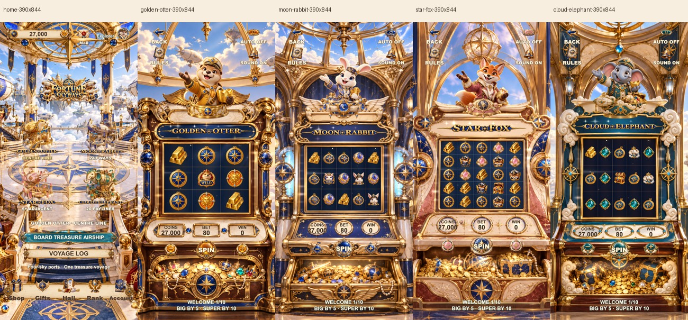
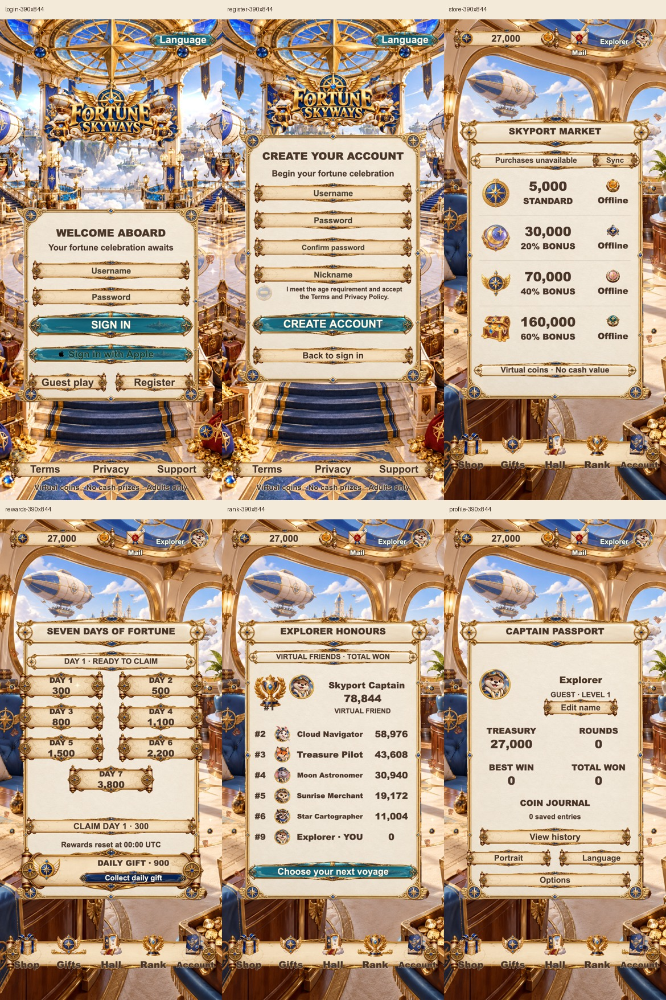
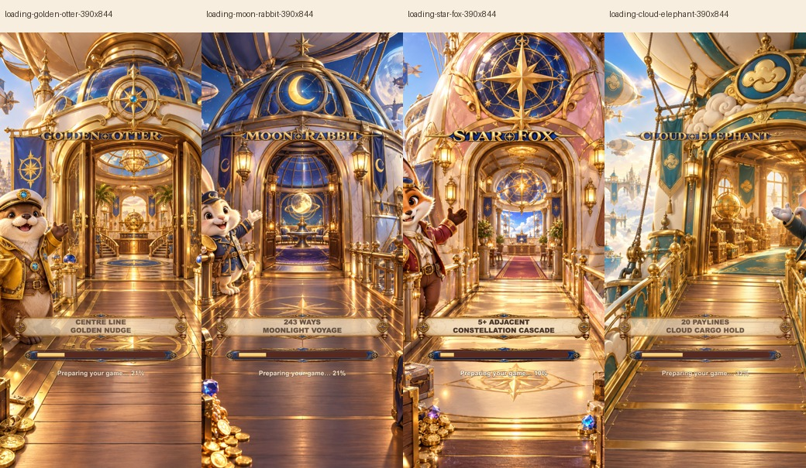
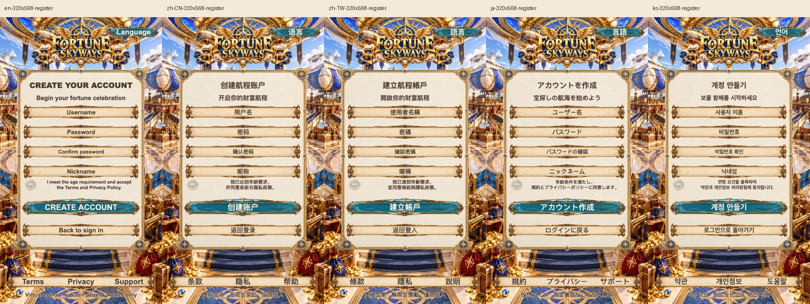
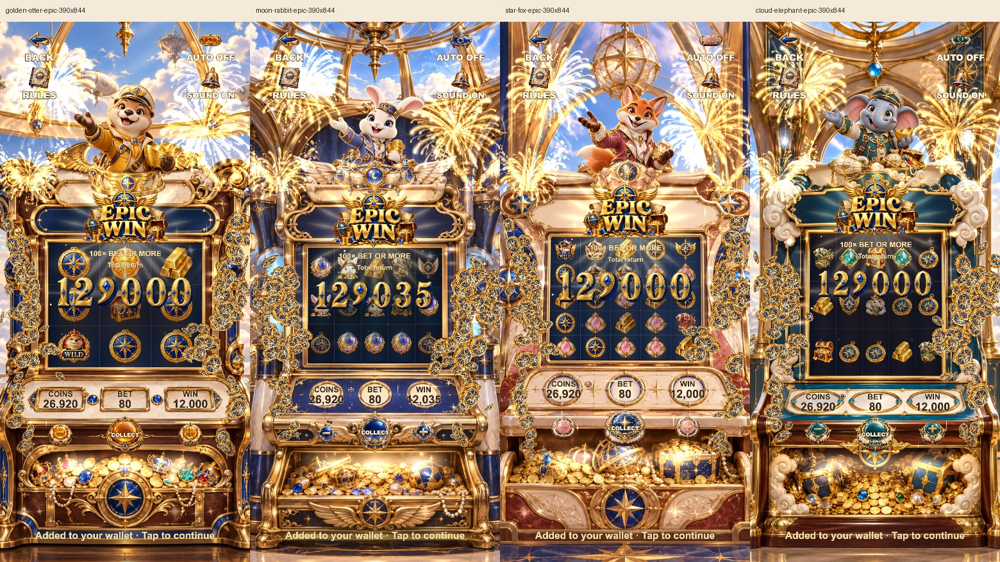

# F44 当前版本截图

2026-10-13，Cocos Creator 引擎导出。本目录为当前版本截图；注册页已更新至最终协议分行。截图用于构图、文字和裁剪，连续运动及结算见 [验收记录](../../acceptance.md)。

## 大厅和四柜机

| 页面 | 390×844 | 320×568 |
|---|---|---|
| 大厅 | [图片](home-390x844.png) | [图片](home-320x568.png) |
| Golden Otter | [图片](golden-otter-390x844.png) | [图片](golden-otter-320x568.png) |
| Moon Rabbit | [图片](moon-rabbit-390x844.png) | [图片](moon-rabbit-320x568.png) |
| Star Fox | [图片](star-fox-390x844.png) | [图片](star-fox-320x568.png) |
| Cloud Elephant | [图片](cloud-elephant-390x844.png) | [图片](cloud-elephant-320x568.png) |

## 服务与加载

登录、注册、商店、奖励、排行、账户两种手机比例的原图在 [services](services/)。

四张加载截图来自实际大厅入口；本工具仅延迟自己持有的图片请求，使真实加载条可见，未在产品中添加假等待。

协议分行与实际语言已另做最终检查，原图和报告位于 [registration-final](../../qa/f44-final-20261013/registration-final/)。

## 四模式奖励演出

演出原图：[水獭](awards/golden-otter-epic-390x844.png)、[月兔](awards/moon-rabbit-epic-390x844.png)、[星狐](awards/star-fox-epic-390x844.png)、[云象](awards/cloud-elephant-epic-390x844.png)。来自实际付费调试回合，仅用于演出及钱包守恒检查，不代表自然中奖频率。
