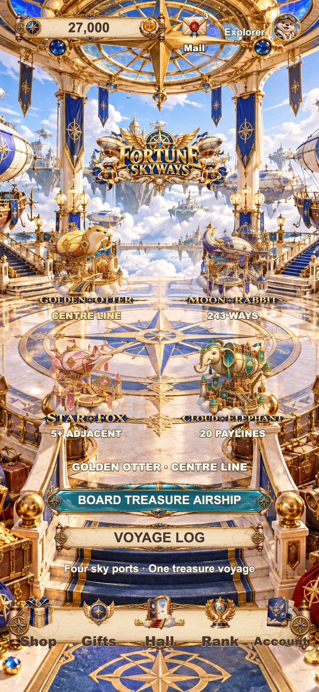
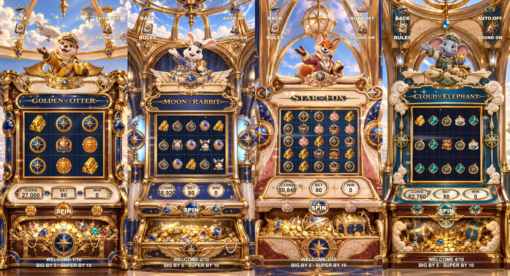

# F44 Git 交付截图 · 2026-10-13

源码版本：`f44-grand-prize-20261013`。所有单图均在本次上传前，从当前端口 6044 的 Cocos 导出重新截取；390×844，DPR 2。

## 大厅

## 四台柜机

## 四台柜机的 EPIC 大奖

| 模式 | 柜机 | 大奖 |
|---|---|---|
| GOLDEN-OTTER | [柜机](golden-otter.jpg) | [EPIC](golden-otter-epic.jpg) |
| MOON-RABBIT | [柜机](moon-rabbit.jpg) | [EPIC](moon-rabbit-epic.jpg) |
| STAR-FOX | [柜机](star-fox.jpg) | [EPIC](star-fox-epic.jpg) |
| CLOUD-ELEPHANT | [柜机](cloud-elephant.jpg) | [EPIC](cloud-elephant-epic.jpg) |

大奖单图来自独立测试账户的实际下注/结算回合，使用强制 EPIC 结果捕获演出；不用于说明自然中奖概率。静态图片只用于检查构图、裁剪及可读性，连续演出验收见[报告](../../qa/f44-grand-prize-20261013/motion/direct-canvas-audit.json)。

[本次截图记录](capture-audit.json) · [完整验收](../../acceptance.md)

完整原始录像与历史大批 QA 画面保留在本机，不纳入此 Git 交付；仓库包含这九张当前单图、两张总览与必要的文字报告。
