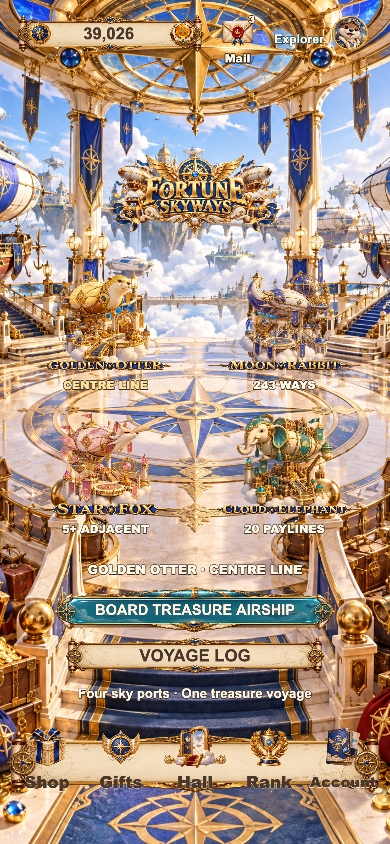

# F44 · 2026-10-13 检查优化截图

当前 Cocos 导出 `build/web-polish-20261013`，预览版本 `f44-polish-20261013`。本页全部截图重新取自该导出，未沿用初次交付图片。

本轮修正：奖励图片数字的逗号/小数点比例、等距字位、按最终金额预留尺度，以及演出期间钱包读数的及时刷新。截图用于检查画面、金额、裁剪与可读性；连续过程另有实际录制和逐帧检查。

## 大厅

## 四台柜机

| 模式 | 待机 | EPIC 演出 |
|---|---|---|
| Golden Otter | [手机截图](golden-otter-390x844.png) | [演出截图](golden-otter-epic-390x844.png) |
| Moon Rabbit | [手机截图](moon-rabbit-390x844.png) | [演出截图](moon-rabbit-epic-390x844.png) |
| Star Fox | [手机截图](star-fox-390x844.png) | [演出截图](star-fox-epic-390x844.png) |
| Cloud Elephant | [手机截图](cloud-elephant-390x844.png) | [演出截图](cloud-elephant-epic-390x844.png) |

这些 EPIC 来自实际扣款与结算的强制结果检查，不能作为自然中奖概率证据。各回合只有一次扣款、一次派奖，演出结束后没有残留遮罩与庆祝音频状态。

## 小屏与细节

- [320×568 水獭柜机](golden-otter-320x568.png)：完整显示操作区，无文档滚动。
- [奖金额与已结算余额细节](award-and-wallet-detail.png)。
- [五语言、两金额的小屏检查](../../qa/f44-polish-20261013/award-copy/copy-audit.json)：2,537 与 12,345,678；长金额仅为排版夹具，不改钱包。
- [四模式连续录制与 1,052 帧金额/钱包检查](../../qa/f44-polish-20261013/motion/motion-audit.json)。本地视频位于对应模式的 `continuous.webm`，按 Git 忽略规则排除。
- [源码与导出哈希](../../qa/f44-polish-20261013/delivery/manifest.json) · [验收记录](../../acceptance.md)。
