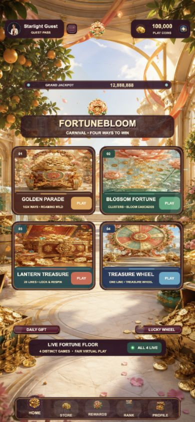

# FORTUNE BLOOM CARNIVAL — F6 v1.0.0

## 运行截图



原创 Cocos Creator 3.8.8 竖屏完整 Slots 模板。F6 的统一世界观是一座轻松喜庆的“财富花园嘉年华”：香槟金、温润珐琅、牡丹琉璃、红金灯笼与晴空蓝构成柔和但华丽的商业质感；金币、宝箱、花朵和灯笼贯穿登录、加载、大厅、商城、账户与大奖演出。

## 四款独立游戏

- `GOLDEN PARADE`：5×4、1024 Ways；票券触发 6 局移动 Wild 财富巡游。
- `BLOSSOM FORTUNE`：5×5 Cluster Pays；花朵连消并提升递增倍率。
- `LANTERN TREASURE`：5×3、20 条固定线；6 枚锁币触发三命 Lock & Respin。
- `TREASURE WHEEL`：3×3 单中线经典玩法；3 张票券开启实体财富转盘奖励。

## 商业模板基线

- 四台独立实体柜机、四套符号、四套主题按键和四张透明艺术标题，不是统一结构换皮。
- 转轴结果在演出前冻结；Quick Stop、Turbo、Auto 只改变播放节奏，不改变结算。
- 转轴逐列加速、巡航、Hermite 减速、机械回弹；镜片扫光、符号待机弹性、边缘跑灯和 SPIN 环持续运行。
- 共享虚拟金币钱包，含登录/注册/游客、Apple 登录桥接、Consumable IAP、商城、奖励、排行、头像、账户、法律页与账户删除。
- PostgreSQL 权威服务端负责 Spin、钱包、奖励、排行、Apple 交易验证、退款/撤销与幂等结算。
- 1080×1920 竖屏设计；背景 Cover，柜机与交互层同尺度缩放；金额、TOP WIN、WIN、BET、转轴和按钮按四台机身分别定位。
- SPIN 使用扩大后的逻辑热区；转动中再次点按为 Quick Stop，中奖演出中点按可完成计数并排队下一局。

## 验证

```bash
npm ci
npm run typecheck
npm run typecheck:server
npm test
npm run test:rtp
npm run release:audit
```

`release:audit` 会在发行主体、HTTPS 法律链接、正式商品 ID 或法律占位文本未配置时阻断发布。虚拟金币无现金价值、不可提现、不可转让；购买不改变 RTP。
