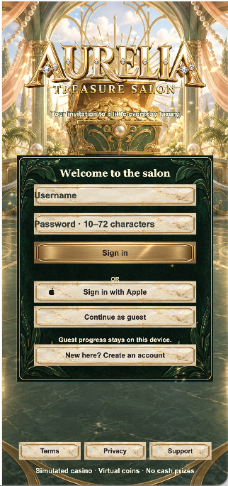

# F8 · Aurelia Treasure Salon【劣质品】

> **质量标记：劣质品（2026-09-09，按用户要求归档）。**
> 本版本未达到用户要求的视觉、动态效果及整体完成度标准，仅保留作问题复盘和源码备份；不得作为高质量参考模版、验收通过版本或可直接上架版本。

## 2026-09-09 交互与动效优化

大厅新增持续卡面推近、主题浮光和沿边星芒，登录/注册页保留宫殿、雕花面板与图片按钮。通过 CC Switch 生成四套独立柜机控件：Golden Hour 使用金库钟盘，Jade Treasury 使用方形玉雕回纹，Pearl Palace 使用贝壳珍珠，Ruby Revel 使用切面红宝石；SPIN、加减、AUTO、BET 和 TOP WIN 均随柜机切换。另新增大厅卡片错峰入场、弹窗上移淡入、提示淡出、中奖及连消星芒粒子和普通中奖音效。修复减少动态模式的金额回写竞态、切换柜机加载失败导致配置错配、AUTO 标签残留引用和启动时音效偏好未恢复。连消先校验存活符号，再修改画面。

预览已使用本机 Cocos Creator 3.8.8 重新构建。新增回归脚本 `tools/browser-optimization-qa.js`，与原有 Playwright run-code 脚本使用方式一致。历史质量标记保留，当前修改仍待用户视觉验收。

2026-09-09：F8 已恢复独立源码并重新构建，不再使用分离时混合的浏览器快照。

## 登录页预览



## 目录与预览

- 本目录为 F8 后续工作的唯一修改目录；不再修改 F7。
- F7 原目录保留，没有移动、删除或覆盖。
- 预览：`python3 tools/preview_server.py`，默认地址 `http://127.0.0.1:4310/`。
- `build/web-mobile` 为本次源码重新生成的预览。
- 在其他机器首次打开时，Cocos 需要重新导入资源并生成本机缓存。
- node_modules 暂时保留原有的 F5 依赖目录链接；交付到其他电脑时应运行 npm ci。

## 本次修复

- 恢复 Golden Hour、Jade Treasury、Pearl Palace、Ruby Revel 四款原始游戏及对应配置、规则与资源。
- 柜机和环境使用一张完整画面，转轴、余额、按钮采用同一坐标平面等比缩放；逐款调整读数和按钮位置。
- 标题保留原图比例；窄金额面板使用单独纹理与九宫格，避免装饰拉伸。
- 待机镜面扫光、柜机光斑和符号轻微弹性运动可见，保留减少动态效果设置；大奖期间隐藏底层读数，避免庆祝文字重叠。
- 修复 Ruby 连消在 Cocos 网页编译后集合展开错误导致动画中断的问题；补充构建后检查。
- 修复注册输入框默认标签、网页输入样式限制、条款返回后的输入保留；扩大登录面板，改善底部说明对比度。

原始资源名称中的 f7 以及存档键暂时保留，避免只改文件名造成动态加载失效；独立预览端口隔离了浏览器本地存档。未改动支付商品 ID、服务端接口或生产配置。

## 验证与构建

```sh
npm run typecheck
npm run typecheck:math
npm run typecheck:server
npm test
node --import tsx tools/release-audit.ts
```

使用 Cocos Creator 3.8.8，构建配置为 `tools/web-mobile-release-build.json`。
浏览器复测脚本在 `tools/browser-game-qa.js`、`tools/browser-auth-qa.js`、`tools/browser-win-qa.js`；截图在 `output/playwright/`。这些脚本传给 Playwright 的 `run-code`，不是直接运行的 Node 脚本。

已通过四款游戏的浏览器点击、AUTO 状态、规则关闭及旋转中尺寸变化检查；布局测试覆盖 32 个游戏/视口组合。浏览器模拟不等于 iPhone 真机认证，4000 次数学回归也不是 RTP 认证。

## 资源清理

运行时资源只保留已使用画面及图集，制作原图放在 `tools/art-sources/`，不随运行时资源发布。移出的旧柜机图、外来 generated 目录及九个未使用组件保存在 `/private/tmp/f8-unused-backup-TJfejS`，可恢复；临时目录可能被系统清理，如需长期保留请另行备份。当前运行时美术约 28 MB，网页构建约 39 MB。

## 发布边界

静态发布检查目前为 20/24：发布者/法律链接、商品 ID、正式法律文档和条款版本重新确认流程仍是阻塞项。Apple 登录、StoreKit、服务端部署及真机购买/退款/删除账户等流程需要正式配置和端到端验证，不能将当前本地预览称为可直接上架版本。

金币仅用于模拟游戏，无现金兑换。本次没有 Git 提交或推送。详细结果见 `F8_FIX_REPORT.md`。
