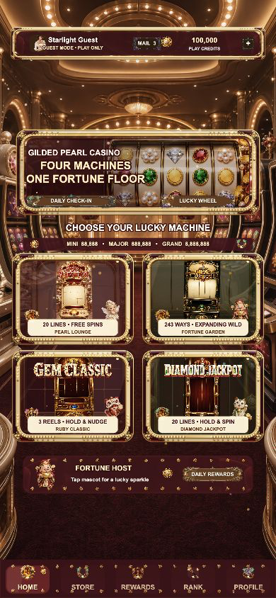

# GILDED PEARL EMPIRE v1.0.0

## 运行截图



基于 CELESTIAL SPIN WORLD 模板重制的原创 Cocos Creator 3.8.8 竖屏 Slots 合集。统一采用柔和轻奢的香槟金、珍珠白、玫瑰金与宝石点缀，包含四款完整玩法、账号/游客入口、试玩金币、奖励中心、设置、移动端安全区、图片边框、动态背景、程序化音效和高级财富 VFX。

主背景与财富符号图集由本机 CC Switch `/v1/responses + image_generation` 生成，真实响应链记录于 `CC_SWITCH_ASSET_MANIFEST.md`。

## 项目内容

- `assets/`：Cocos 场景、TypeScript、原创图片和材质。
- `build-templates/web-mobile/`：移动 Web 加载页与限制为同源资源的 CSP 模板；Cocos 3.8.8 运行时需要受限的 `unsafe-eval` 兼容项。
- `server/`：服务器权威账号、HttpOnly 会话、CSRF、Spin 与幂等结算参考实现。
- `tools/`：数学、账号隔离、异常恢复和 RTP 自动测试。
- `ART_BIBLE.md`、`MATH_REPORT.md`、`SECURITY.md`：美术、数学和上线安全基线。

## 开发与验证

```bash
npm ci
npm run typecheck
npm run typecheck:server
npm test
npm run test:rtp
```

直接运行已构建的 Web 版本：

```bash
npm start
```

然后打开 `http://127.0.0.1:4191/`。不要直接双击 `build/web-mobile/index.html`，浏览器的本地文件限制会阻止 Cocos 资源加载。端口被占用时可改用 `npm start -- --port 4192`。

用 Cocos Creator 3.8.8 打开项目，构建目标选择 `Web Mobile`。本地权威接口演示：

```bash
cp .env.example .env
npm run server:dev
```

## 运行模式

- 本地预览是明确标识的虚拟金币 Demo；游客可玩，不能增加商店金币。
- 正式上线必须让客户端通过 `ProductionApiClient` 连接服务器，由服务器生成 RNG 结果、验证下注并原子结算。
- `force=win/free/hold/mega/epic` 仅在 localhost 且 `debug=1` 时生效，公网环境关闭。
- Store 的线上票据验证接口默认 fail closed；未接入 Apple/Google/渠道服务前不会增加金币。

这是一套可继续商业化的工程基线，不代表第三方 RNG/数学实验室认证、地区牌照、年龄分级、隐私合规或真实支付审核已经完成。上线前按 `DEPLOYMENT_CHECKLIST.md` 完成外部依赖。
