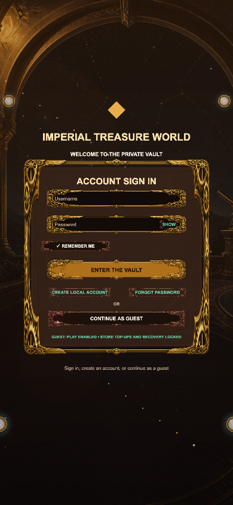
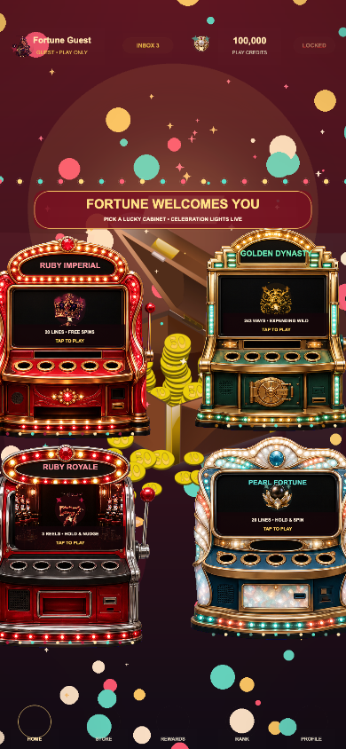
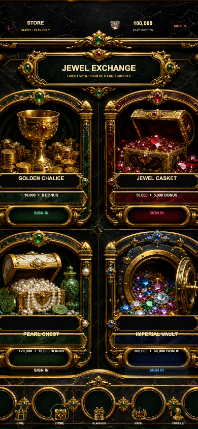
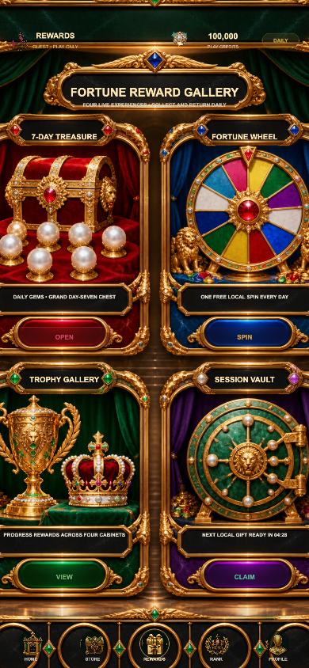
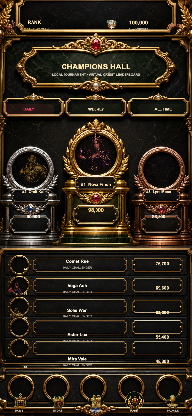
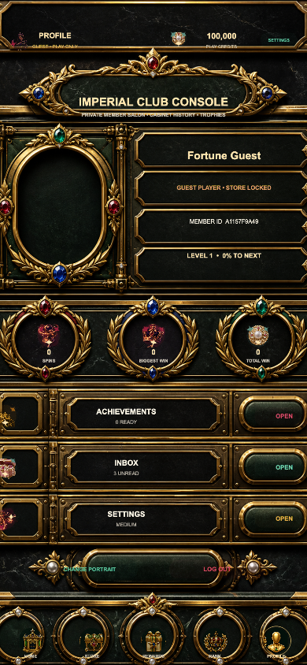
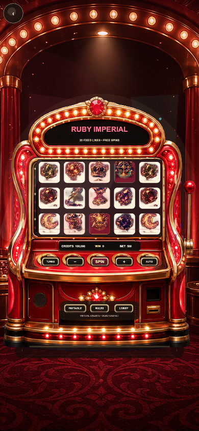
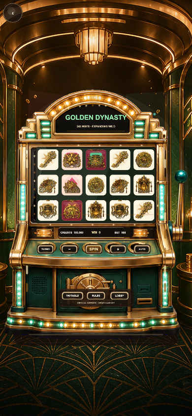
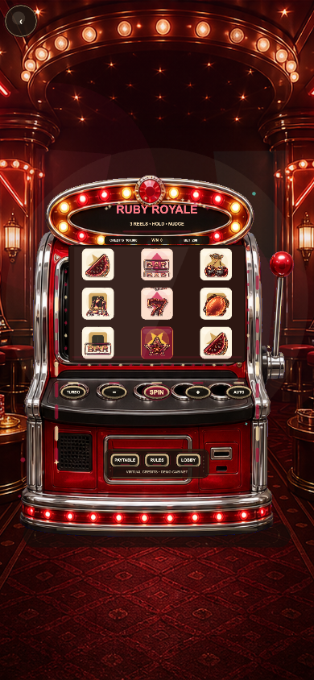

# IMPERIAL TREASURE WORLD v1.0.0

## 运行截图

| 登录 | 大厅 |
| --- | --- |
|  |  |
| 商店 | 奖励 |
|  |  |
| 排行 | 账户 |
|  |  |
| Astral Vault | Golden Dynasty |
|  |  |
| Neon Classic | Cosmic Coins |
|  |  |

以帝王金、黑曜石、红宝石、祖母绿、蓝宝石和珍珠母贝为统一视觉语言的 Cocos Creator 3.8.8 竖屏 Slots 合集。项目由已验证的完整游戏模板派生，保留四款数学玩法、账号/游客入口、试玩金币、奖励中心、设置、移动端安全区、图片边框、人物图、动态背景、程序化音效与 VFX。

## 四个财富世界

- `RUBY IMPERIAL`：红宝石与香槟金皇家宝库，20 条固定线与粘性免费旋转。
- `GOLDEN DYNASTY`：24K 金与帝王绿机关财富城，243 Ways 与扩展 Wild 免费旋转。
- `RUBY ROYALE`：红宝石私人经典赌场，3×3、Hold、Nudge 与 Double。
- `PEARL FORTUNE`：珍珠白高科技金库，20 条固定线与 Hold & Spin。

## 项目内容

- `assets/`：Cocos 场景、TypeScript、财富主题图片、人物、符号和材质。
- `tools/wealth-theme-assets.py`：从保留的原模板源图进行确定性、非破坏式财富主题重制；输出尺寸、透明通道与图集坐标保持不变。
- `build-templates/web-mobile/`：财富主题加载页与限制为同源资源的 CSP 模板；Cocos 3.8.8 运行时需要受限的 `unsafe-eval` 兼容项。
- `server/`：服务器权威账号、HttpOnly 会话、CSRF、Spin 与幂等结算参考实现。
- `tools/`：数学、账号隔离、异常恢复和 RTP 自动测试。

## 开发与验证

```bash
npm ci
npm run typecheck
npm run typecheck:server
npm test
npm run test:rtp
```

用 Cocos Creator 3.8.8 打开项目，构建目标选择 `Web Mobile`。本地权威接口演示：

```bash
cp .env.example .env
npm run server:dev
```

## 运行与上线边界

- 本地预览是明确标识的虚拟金币 Demo；游客可玩，但不能增加商店金币。
- 本版本使用独立的 `imperial-treasure-world.save.v4` 存档，不会读取或覆盖原版玩家数据。
- 正式上线必须让客户端通过 `ProductionApiClient` 连接服务器，由服务器生成 RNG 结果、验证下注并原子结算。
- `force=win/free/hold/mega/epic` 仅在 localhost 且 `debug=1` 时生效，公网环境关闭。
- Store 的线上票据验证接口默认 fail closed；未接入 Apple/Google/渠道服务前不会增加金币。

这是一套可继续商业化的工程基线，不代表第三方 RNG/数学实验室认证、地区牌照、年龄分级、隐私合规或真实支付审核已经完成。上线前按 `DEPLOYMENT_CHECKLIST.md` 完成外部依赖。
