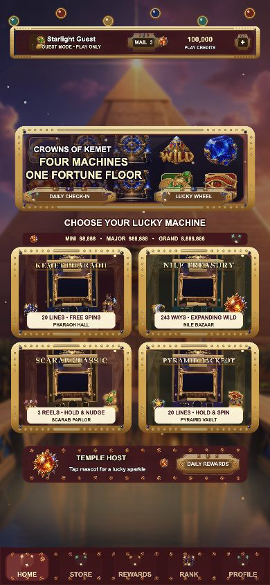

# PHARAOH KEMET TREASURY v1.0.0

## 运行截图



基于 GILDED PEARL EMPIRE 模板重制的原创 Cocos Creator 3.8.8 竖屏 Slots 合集。主题全面更换为古埃及神殿风:尼罗河暮色、鎏金石柱、圣甲虫与法老宝藏,包含四款完整玩法(20 线旋转 / 243 路 / 3×3 经典 / Hold & Spin 头奖)、账号/游客入口、试玩金币、奖励中心、设置、移动端安全区、图片边框、动态背景、程序化音效和高级财富 VFX。

核心美术由 RetroStyle Games《Crowns of Kemet》工作室素材包(游戏内商用许可)与本地程序化生成管线(`tools/asset_pipeline/`,Python + PIL)合成:转轮框、阿努比斯、四枚高阶符号、WILD 与 Logo 为工作室原图;宝石、圣物、机柜、转盘、UI 框架为管线绘制,风格与原图无缝匹配。

## 项目内容

- `assets/`:Cocos 场景、TypeScript、原创图片和材质。
- `build-templates/web-mobile/`:移动 Web 加载页与限制为同源资源的 CSP 模板。
- `server/`:服务器权威账号、HttpOnly 会话、CSRF、Spin 与幂等结算参考实现。
- `tools/`:数学、账号隔离、异常恢复、RTP 自动测试与 `asset_pipeline` 美术管线。
- `ART_BIBLE.md`、`MATH_REPORT.md`、`SECURITY.md`:美术、数学和上线安全基线。

## 开发与验证

```bash
npm ci
npm run typecheck
npm run typecheck:server
npm test
npm run test:rtp
python3 tools/asset_pipeline/gen_symbols.py   # 重新生成符号图集
python3 tools/asset_pipeline/gen_cabinets.py  # 重新生成机柜背景
python3 tools/asset_pipeline/gen_ui.py        # 重新生成通用 UI
```

直接运行已构建的 Web 版本:

```bash
npm start
```

然后打开 `http://127.0.0.1:4191/`。不要直接双击 `build/web-mobile/index.html`,浏览器的本地文件限制会阻止 Cocos 资源加载。端口被占用时可改用 `npm start -- --port 4192`。

用 Cocos Creator 3.8.8 打开项目,构建目标选择 `Web Mobile`。本地权威接口演示:

```bash
cp .env.example .env
npm run server:dev
```

## 运行模式

- 本地预览是明确标识的虚拟金币 Demo;游客可玩,不能增加商店金币。
- 正式上线必须让客户端通过 `ProductionApiClient` 连接服务器,由服务器生成 RNG 结果、验证下注并原子结算。
- `force=win/free/hold/mega/epic` 仅在 localhost 且 `debug=1` 时生效,公网环境关闭。
- Store 的线上票据验证接口默认 fail closed;未接入 Apple/Google/渠道服务前不会增加金币。

## 数学基线(RTP 实测,10 万次仿真)

| 游戏 | 模式 | RTP | 命中率 | 功能触发率 |
|------|------|-----|--------|-----------|
| KEMET PHARAOH | 5×3 · 20 线 · Sticky Wild 免费旋转 | 96.09% | 33.3% | 2.75% |
| NILE TREASURY | 5×3 · 243 路 · 扩展 Wild 免费旋转 | 95.85% | 53.7% | 3.13% |
| SCARAB CLASSIC | 3×3 · 5 线 · Nudge 经典机 | 96.32% | 47.7% | 23.7% |
| PYRAMID JACKPOT | 5×3 · 20 线 · Hold & Spin 头奖 | 95.66% | 31.0% | 3.04% |

这是一套可继续商业化的工程基线,不代表第三方 RNG/数学实验室认证、地区牌照、年龄分级、隐私合规或真实支付审核已经完成。上线前按 `DEPLOYMENT_CHECKLIST.md` 完成外部依赖。
