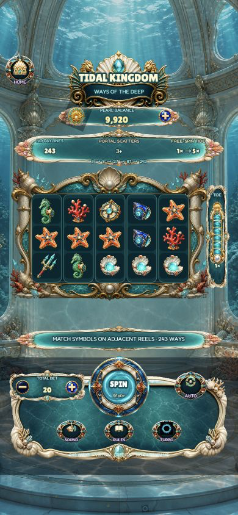

# S04 Tidal Kingdom — 5×3 243 Ways Free Spins

## 运行截图



Version 1.0.0. A responsive Cocos Creator 3.8.8 slot template for desktop and mobile browsers.

## Distinct gameplay

- Five reels, three rows and 243 Ways; there are no fixed paylines.
- Wins begin on reel 1 and continue across adjacent reels. Every matching position creates another winning way.
- WILD substitutes for all regular symbols.
- 3 / 4 / 5 PORTAL SCATTERS award 8 / 12 / 15 free spins.
- Three SCATTERS during free spins add three more spins.
- Free spins start at 1×. Every winning free spin raises the persistent TIDE multiplier by one, up to 5×.
- The dedicated tide meter, live reel-to-reel Ways path, free-spin status bar and feature presentation are functional gameplay UI, not decorative reskins.

## Player experience

- A reel-centric portrait composition with five channelled reels, an attached TIDE instrument, a centered SPIN control and separate wager/Auto controls; landscape and desktop use a purpose-built two-zone layout.
- Animated reel cycling, elastic landings, quick stop, Auto 10, Turbo, sound, symbol inspection and responsive HOME.
- Readable Fredoka/Lilita One typography, strong contrast and non-overlapping English rules.
- A clearly labelled `TRY FREE-SPIN DEMO`; demo results never alter the credit balance.
- Local virtual-credit recharge, linear balance counting, real coin-flight effects and local persistence.
- Image-led HTML loading scene, restrained underwater ambient motion and reduced-motion support.

## Run

Double-click `RUN_GAME.command`, or open this directory in Cocos Creator 3.8.8 and build Web Mobile. The included build is in `build/web-mobile`.

## Verify math

```bash
npm ci
npm run test:math
```

All credits are virtual and have no cash value. CC Switch credentials are never stored in the project.
