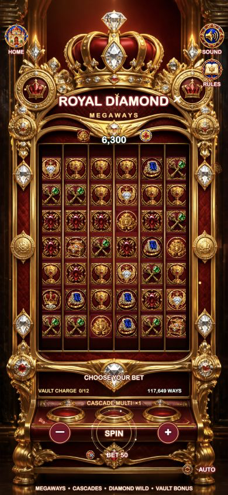

# S08 · Royal Diamond Megaways

## 运行截图



高品质竖屏 6 转轴 Megaways 连消 Slots 模版，使用 Cocos Creator 3.8.8 与 TypeScript。

## 核心玩法

- 6 个转轴，每轴每次随机显示 2–7 个有效 Symbol。
- 动态 Ways，最高 `117,649` 种组合。
- 从最左侧开始连续 3 个以上转轴匹配即中奖，WILD 可替代普通 Symbol。
- 中奖后触发真实坠落连消，连消倍率从 `1×` 逐级增长。
- 4 个 Crown Scatter 奖励 7 次免费旋转。
- 收集 12 个 Coin Stack 或落下 4 个 Vault Chest 可开启可点击的 Diamond Vault 奖励。

## 交互与表现

- HOME、SOUND、RULES、充值、BET−、BET+、SPIN/STOP 和 AUTO 均有真实功能与按压反馈。
- 余额扣除与派奖均线性计数，大奖使用金币流、粒子、冲击波和图片舞台组合表现。
- 单一品牌加载画面，不显示引擎黑底 Logo，不出现二次加载框或红色闪帧。
- 设计分辨率 `750 × 1624`，支持窄竖屏、宽竖屏和桌面浏览器居中显示。

## 开发命令

```bash
npm run theme:validate
npm run build:web
```

主题配置：`assets/resources/config/royal-diamond.json`
