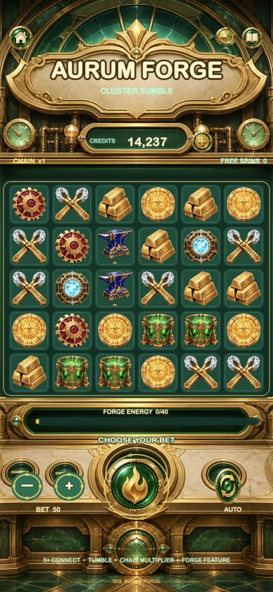

# S09 · Aurum Forge 6×5 Cluster Tumble Slot

## 运行截图



商业级竖屏 Cocos Creator 3.8.8 + TypeScript Slots 模板。主题是香槟金、熔金与祖母绿玻璃构成的财富铸造厂，核心玩法是 6×5 Cluster Pays、连锁掉落、递增倍率和 Forge Energy 奖励。它与 S07 的 1024 Ways + Fortune Wheel 是不同数学和交互结构。

## 打开与运行

1. 在 Cocos Dashboard 导入本目录。
2. 使用 Cocos Creator `3.8.8`。
3. 打开 `assets/scenes/Main.scene`。
4. 点击 Preview，或执行 `npm run build:web` 构建 Web Mobile。

Web 构建只显示一次 Aurum Forge 品牌加载页，游戏准备完成后平滑交接到机柜。

## 玩法与功能

- 6 列 × 5 行，正交相邻的 5+ 同 Symbol 组成中奖 Cluster
- 中奖图标消除后上方图标自然掉落补位，继续计算连锁
- 掉落链倍率按 `1× / 2× / 3× / 5× / 8×` 递增
- WILD 可参与 Cluster；3+ Scatter 奖励 6 次免费旋转
- 中奖 Cluster 累积 Forge Energy，达到 40 触发熔炉奖励
- SPIN、AUTO/STOP、BET ±、SOUND、RULES、充值与 HOME 都有真实反馈
- 弹性掉落、Cluster 高亮、熔金能量、金币流和分级获奖舞台
- 750×1624 竖屏设计，重点验收 390×844 手机视口

## 配置

主题配置在 `assets/resources/config/aurum-forge.json`。可调整投注、Cluster 最小数量、Symbol 权重/价值、掉落倍率、免费旋转和 Forge Energy 目标。

```bash
npm run theme:validate
npm run build:web
```

## 商业化说明

当前数学模型用于高保真游戏原型，不是经过独立审计的现金博彩模型。上线真实货币产品前，需替换为合规 RNG/RTP 数学包，并完成年龄、隐私、付费和地区合规。
